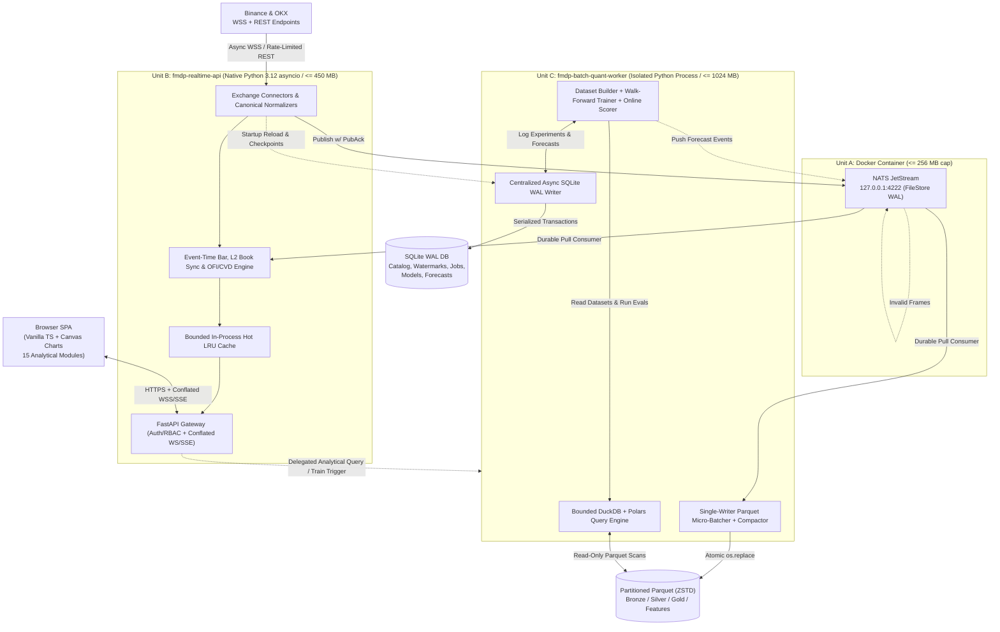

# C4 Level 2 — Container & Process Boundaries

## Legend & Diagram Metadata

- **Solid Arrows (`-->`)**: Primary real-time ingestion, JetStream delivery, and storage write paths.
- **Dashed Arrows (`-.->`)**: Metadata checkpoints, DLQ routing, and isolated worker delegation.
- **Authoritative Spec**: [system-architecture-document.md](../architecture/system-architecture-document.md).

