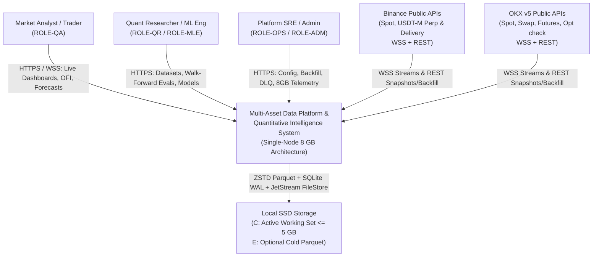

# C4 Level 1 — System Context

## Legend & Diagram Metadata

- **Solid Arrows (`-->`)**: Primary active external integrations and user-to-system channels.
- **Authoritative Spec**: [vision-and-scope.md](../product/vision-and-scope.md), [system-architecture-document.md](../architecture/system-architecture-document.md).

