# End-to-End Streaming & Quantitative Data Flow

```mermaid
flowchart LR
    RAW_FEED["Binance & OKX WSS / REST<br/>(Spot, Perp/Swap, Expiry Futures)"] --> NORM["Venue Normalizer & Decimal Cast<br/>(Preserve Source Provenance)"]

    NORM -->|Valid Canonical EventEnvelope| JS["NATS JetStream FileStore<br/>mkt.raw.* / mkt.norm.*"]
    NORM -.->|Malformed / Negative / Bad Schema| DLQ["Dead-Letter Stream<br/>mkt.dlq.*"]

    JS -->|Hot Consumer| RTP["Event-Time Engine & L2 Book Sync<br/>Check seqId / u / pu & Crossed Spread"]
    RTP -.->|Sequence Gap Detected| RESYNC["Invalidate Book + Emit UNSYNCED<br/>Trigger REST Snapshot Resync"]
    RTP -->|Valid State: OHLCV, OFI, CVD, Basis| HOT["Bounded Hot LRU Cache"]
    HOT --> WS["FastAPI Conflated WS / REST"]

    JS -->|Batch Pull Consumer| BRONZE["Bronze ZSTD Parquet<br/>(Raw + Normalized Envelope)"]
    BRONZE --> SILVER["Silver Canonical Merge<br/>(Deduped Trades, Bars, Book Snapshots, OI/Funding)"]
    SILVER --> DQG{"DQ Gate<br/>Monotonic? Bounds? Gaps?"}
    DQG -->|PASS| GOLD["Gold Microstructure, Cross-Asset<br/>& Feature Parquet"]
    DQG -.->|FAIL| DQ_BLOCK["Block Gold Promotion<br/>Log Failure in SQLite WAL"]

    GOLD --> PIT["Point-in-Time Dataset Builder<br/>(available_at <= decision_time)"]
    PIT --> WF["Tier 0/1/2 Walk-Forward Eval<br/>(Net Fees + Slippage + Funding)"]
    WF -->|Beats Tier 0| REG["SQLite Model Registry"]

    HOT & REG --> INF_GATE{"Inference DQ & Drift Gate<br/>Fresh? Synced? PSI OK?"}
    INF_GATE -->|HEALTHY| PRED["Emit Forecast + q10/q50/q90<br/>+ Feature Drivers"]
    INF_GATE -.->|DEGRADED / UNSYNCED| ABSTAIN["Emit ABSTAINED Flag<br/>+ Explicit Degraded Reason"]
```

## Legend & Diagram Metadata

- **Solid Arrows (`-->`)**: Nominal verified path.
- **Dashed Arrows (`-.->`)**: Error quarantine (`DLQ`), L2 book recovery, DQ promotion block, and inference abstention safety path.
- **Authoritative Spec**: [srs.md](../product/srs.md), [system-architecture-document.md](../architecture/system-architecture-document.md).
