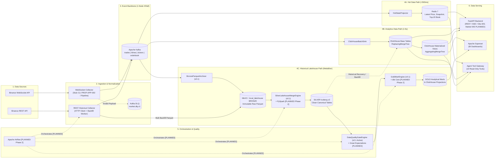

# Diagram 04: Overall Data Platform Architecture (`DIAG-DATA-004`)

| Diagram Metadata | Value |
|---|---|
| **Diagram ID** | `DIAG-DATA-004` |
| **Title** | Overall Data Platform Architecture |
| **Diagram Category** | `docs/diagrams/data-platform/` |
| **Notation / Mermaid Type** | `Mermaid (flowchart LR)` |
| **Status** | `IMPLEMENTED` / `PARTIALLY_IMPLEMENTED` (v0.1 Python Lakehouse & DQ engines active; PySpark/dbt-runner/Airflow/GE Phase 2 targets `[PLANNED]`) |
| **Version** | `1.1.0` |
| **Authoritative Document Reference** | `docs/architecture/04-data-platform-architecture.md` |
| **Canonical Model Reference** | `models/data-platform/datasets.yaml` |
| **Related Artifact IDs** | `FR-01`..`FR-10`, `COMP-001`..`COMP-014` |

## Architectural Explanation

The **Overall Data Platform Architecture** illustrates the **Streaming-First Hybrid Lakehouse** divided into three parallel workload-optimized data paths (`AC-004` non-summed branches):
1. **Hot Data Path (Sub-Second Latency — `[IMPLEMENTED]`)**: `Collector -> Kafka -> HotStateProjector -> Redis` for latest prices, 24h ticker snapshots, and live observability fan-out (`SSE /api/v1/observability/stream` & `WS /ws/v1/observability/stream`; `/ws/v1/market/stream` is `[PLANNED]`).
2. **Analytics Data Path (Micro-Batch OLAP — `[IMPLEMENTED]`)**: `Kafka -> ClickHouseBatchSink -> ClickHouse ReplacingMergeTree -> Materialized Views` for historical candle queries, trade history, rolling market statistics, and Apache Superset BI dashboards.
3. **Historical Data Lakehouse Path (Medallion — v0.1 `[IMPLEMENTED]` + Phase 2 `[PLANNED]`)**: v0.1 Python engines (`BronzeParquetArchiver`, `SilverLakehouseMergeEngine`, `GoldMartEngine`, `DataQualityGateEngine` with `DQ-KLINE-001..005` & `DQ-TRADE-001..003`) write `.local_lakehouse/` Parquet + Iceberg v2 manifests and MinIO S3; full distributed `PySpark`, `dbt Core` container, `Apache Airflow`, and `Great Expectations` suites remain `[PLANNED — Phase 2]`.

