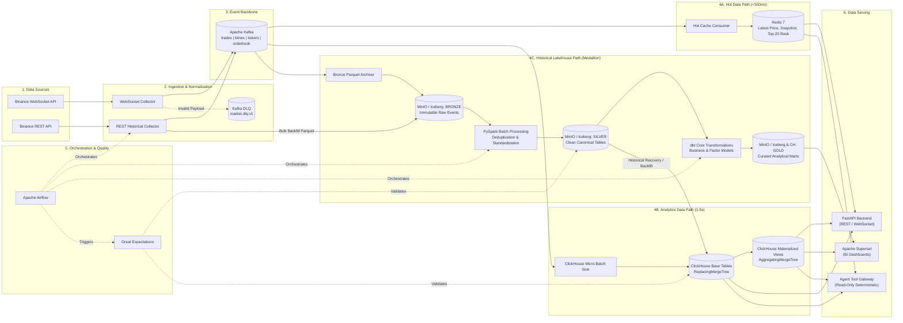

# Diagram 04: Overall Data Platform Architecture

## Architectural Explanation

The **Overall Data Platform Architecture** illustrates the **Streaming-First Hybrid Lakehouse** divided into three workload-optimized data paths:
1. **Hot Data Path (Sub-Second Latency)**: `Binance WebSocket -> Collector -> Kafka -> Hot Consumer -> Redis` for latest prices, 24h ticker snapshots, and live WebSocket fan-out.
2. **Analytics Data Path (1–5s Micro-Batch OLAP)**: `Kafka -> ClickHouse Consumer -> ClickHouse ReplacingMergeTree -> Materialized Views` for low-latency historical candle queries, trade history, rolling market statistics, and Apache Superset BI dashboards.
3. **Historical Data Lake Path (Durable Medallion Lakehouse)**: `Kafka / REST Backfill -> MinIO (Parquet + Apache Iceberg) -> PySpark (Bronze to Silver) -> dbt Core (Silver to Gold)` orchestrated by Apache Airflow and validated by Great Expectations.

