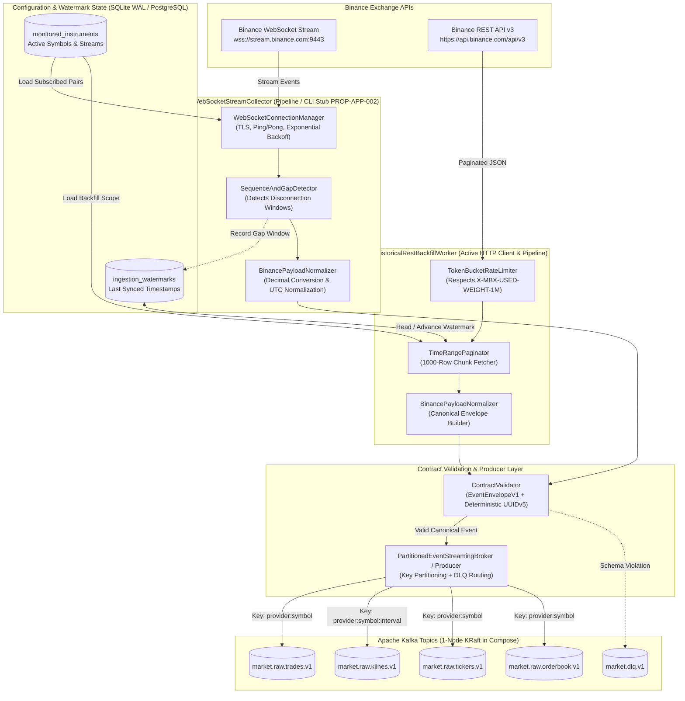

# Diagram 05: Data Ingestion Architecture (`DIAG-DATA-005`)

| Diagram Metadata | Value |
|---|---|
| **Diagram ID** | `DIAG-DATA-005` |
| **Title** | Data Ingestion Architecture |
| **Diagram Category** | `docs/diagrams/data-platform/` |
| **Notation / Mermaid Type** | `Mermaid (flowchart TB)` |
| **Status** | `IMPLEMENTED` / `PARTIALLY_IMPLEMENTED` (REST backfill & normalization active in v0.1 pipeline; standalone worker daemons `[PROP-APP-002]` pending) |
| **Version** | `1.1.0` |
| **Authoritative Document Reference** | `docs/architecture/04-data-platform-architecture.md`, `docs/architecture/08-data-flow-and-event-contracts.md` |
| **Canonical Model Reference** | `models/process/processes.yaml` |
| **Related Artifact IDs** | `FR-01`, `FR-02`, `FR-03`, `PROC-001`, `PROP-APP-002` |

## Architectural Explanation

The **Data Ingestion Architecture** details how real-time WebSocket streams and paginated REST historical endpoints are ingested reliably:
- **Symbol Subscription & Watermark State**: Active configuration/watermark stores use SQLite WAL (`src/ingestion/infrastructure/watermark_store.py`) locally and PostgreSQL control schema in Docker Compose (`monitored_instruments`, `ingestion_watermarks`).
- **WebSocket & REST Workers**: `WebSocketStreamCollector` tracks sequence gaps via `SequenceAndGapDetector`; `HistoricalRestBackfillWorker` obeys Binance `X-MBX-USED-WEIGHT-1M` headers via `TokenBucketRateLimiter`. Note `[PROP-APP-002]`: standalone Compose CLI entrypoints (`ws_collector.py`, `rest_backfill.py`) are currently stubs while active ingestion runs via `backend-api` / `svc-data-plane-v01`.
- **Normalization & Validation Gate**: Raw exchange JSON is mapped via `BinancePayloadNormalizer` into `EventEnvelopeV1` with deterministic UUIDv5 `event_id` and published to Kafka (1-node KRaft in Compose; malformed payloads routed to `market.dlq.v1`).

