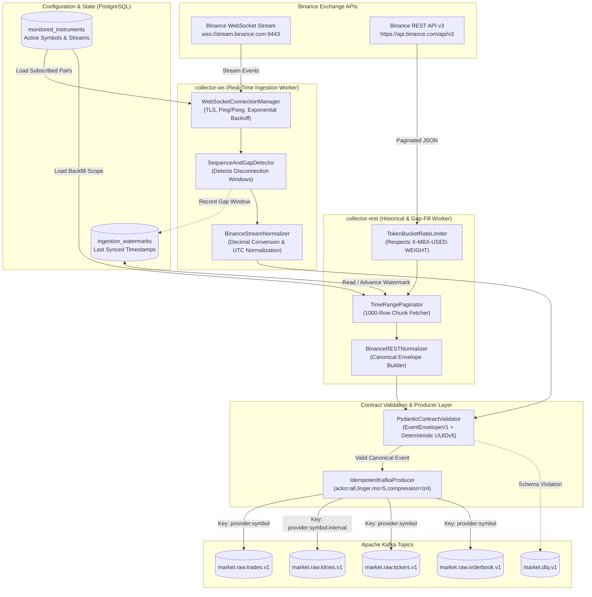

# Diagram 05: Data Ingestion Architecture

## Architectural Explanation

The **Data Ingestion Architecture** details how both real-time WebSocket streams and paginated REST historical endpoints are ingested reliably:
- **Symbol Subscription Sync**: Collectors load active symbol configurations (`BTCUSDT`, `ETHUSDT`, etc.) from PostgreSQL on startup and refresh periodically.
- **WebSocket Resilience**: `collector-ws` maintains multiplexed connections, tracks heartbeat pings/pongs, reconnects with exponential backoff + jitter on disconnect, and records any timestamp gap so `collector-rest` can backfill missed klines/trades.
- **Normalization & Validation Gate**: Raw exchange JSON is mapped through a provider-specific adapter (`BinanceNormalizer`) into the canonical `EventEnvelopeV1` Pydantic contract with a deterministic UUIDv5 `event_id` before publishing to Kafka. Malformed payloads are isolated in `market.dlq.v1`.

