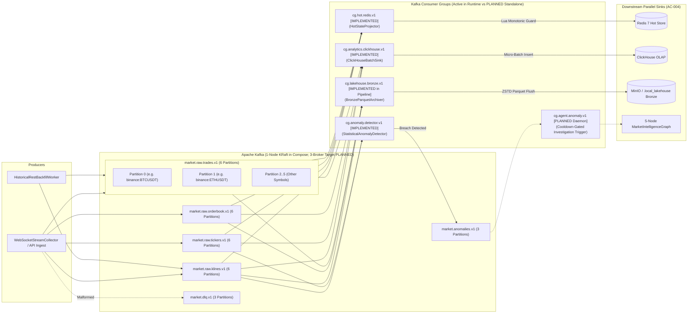

# Diagram 06: Event Streaming Architecture (`DIAG-DATA-006`)

| Diagram Metadata | Value |
|---|---|
| **Diagram ID** | `DIAG-DATA-006` |
| **Title** | Event Streaming Architecture |
| **Diagram Category** | `docs/diagrams/data-platform/` |
| **Notation / Mermaid Type** | `Mermaid (flowchart LR)` |
| **Status** | `IMPLEMENTED` / `PARTIALLY_IMPLEMENTED` (`cg.agent.anomaly.v1` standalone consumer `[PLANNED]`; Compose runs 1-node KRaft) |
| **Version** | `1.1.0` |
| **Authoritative Document Reference** | `docs/architecture/08-data-flow-and-event-contracts.md`, `docs/specifications/data-contracts.md` |
| **Canonical Model Reference** | `models/data-platform/topics.yaml`, `models/data-platform/events.yaml` |
| **Related Artifact IDs** | `EVT-001`..`EVT-005`, `TOP-001`..`TOP-006`, `AC-004` |

## Architectural Explanation

The **Event Streaming Architecture** illustrates how Apache Kafka (configured as a **1-node KRaft** broker in `docker-compose.yml` alongside `PartitionedEventStreamingBroker` in runtime; 3-broker HA replication is a `[PLANNED]` production target) decouples producers from independent consumer groups (`AC-004` parallel post-Kafka branches):
1. **Partition-Level Ordering**: Raw topics partition by `{provider}:{symbol}` (or `{provider}:{symbol}:{interval}` for klines) across `6` partitions (`3` partitions on `market.anomalies.v1` and `market.dlq.v1`).
2. **Consumer Group Status**:
   - `cg.hot.redis.v1` (`[IMPLEMENTED]`): Low-latency updates to Redis via Lua monotonic timestamp guard (`HotStateProjector`).
   - `cg.analytics.clickhouse.v1` (`[IMPLEMENTED]`): Micro-batched inserts into ClickHouse `ReplacingMergeTree` tables (`ClickHouseBatchSink`).
   - `cg.lakehouse.bronze.v1` (`[IMPLEMENTED]` in v0.1 pipeline; standalone `bronze/consumer.py` CLI is `[PROP-APP-002]` stub): ZSTD Parquet flushes into Bronze storage (`BronzeParquetArchiver`).
   - `cg.anomaly.detector.v1` (`[IMPLEMENTED]`): Evaluates klines/tickers via `StatisticalAnomalyDetector` and emits breaches to `market.anomalies.v1`.
   - `cg.agent.anomaly.v1` (`[PLANNED]` standalone consumer loop): Target autonomous investigation trigger consuming `market.anomalies.v1`.

