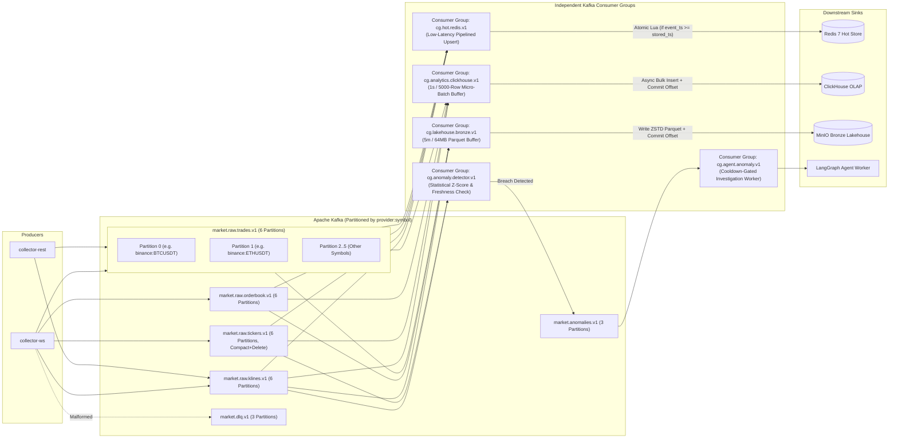

# Diagram 06: Event Streaming Architecture

## Architectural Explanation

The **Event Streaming Architecture** illustrates how Apache Kafka decouples event producers from four independent consumer groups, guaranteeing:
1. **Partition-Level Ordering**: Every topic uses `{provider}:{symbol}` (or `{provider}:{symbol}:{interval}` for klines) as the partition key, ensuring all events for `binance:BTCUSDT` land in the exact same partition in arrival order.
2. **Independent Consumer Group Isolation**:
   - `cg.hot.redis.v1`: Low-latency single-event/pipelined updates to Redis with Lua monotonic timestamp guards.
   - `cg.analytics.clickhouse.v1`: Micro-batched ($1\text{ s}$ or $5,000$ events) bulk inserts into ClickHouse `ReplacingMergeTree` tables; manual offset commit occurs only after ClickHouse write confirmation.
   - `cg.lakehouse.bronze.v1`: Buffered Parquet file flushes ($5\text{ m}$ or $64\text{ MB}$) to MinIO Bronze storage.
   - `cg.anomaly.detector.v1`: Evaluates closed klines and ticker shifts against deterministic statistical thresholds and emits deduplicated alerts to `market.anomalies.v1`.

