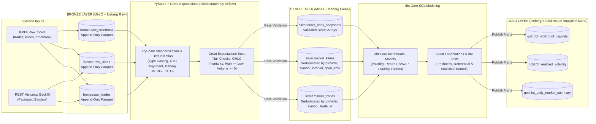

# Diagram 07: Bronze–Silver–Gold Medallion Data Flow

## Architectural Explanation

The **Bronze–Silver–Gold Data Flow** defines the exact division of responsibilities across the Lakehouse and OLAP layers so transformation logic is **never duplicated** across Python scripts, PySpark, and dbt Core:

1. **Bronze Layer (Raw Immutable Archive — Owned by `consumer-lakehouse-bronze` & `collector-rest`)**:
   - Format: ZSTD-compressed Apache Parquet registered in Apache Iceberg catalog (`lakehouse.bronze.*`) on MinIO.
   - Responsibility: Preserve exact incoming event envelopes (`event_id`, `ingested_at`, `raw_payload`, `exchange_event_time`) partitioned by `(provider, ingestion_date)`. Append-only; never mutated.
2. **Silver Layer (Cleaned, Deduplicated, Standardized — Owned by `PySpark` Batch Jobs)**:
   - Format: Apache Iceberg tables (`lakehouse.silver.trades`, `lakehouse.silver.klines`, `lakehouse.silver.order_book_snapshots`).
   - Responsibility: PySpark reads new Bronze snapshots, enforces strict `Decimal(38,18)` and UTC timestamp types, deduplicates records by natural key `(provider, symbol, trade_id)` or `(provider, symbol, interval, open_time)` using `MERGE INTO`, and runs **Great Expectations** validation suites before committing the Silver snapshot.
3. **Gold Layer (Business & Analytical Models — Owned by `dbt Core` & ClickHouse Materialized Views)**:
   - Format: Curated Iceberg tables (`lakehouse.gold.*`) and ClickHouse analytical marts (`analytics.mart_*`).
   - Responsibility: `dbt Core` executes version-controlled SQL models computing daily/hourly OHLCV rollups, realized volatility surfaces, liquidity/spread metrics, and cross-asset return tables consumed by Apache Superset, the Analytics API, and the Agent Tool Gateway.

