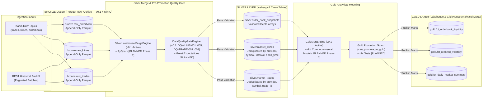

# Diagram 07: Bronze–Silver–Gold Medallion Data Flow (`DIAG-DATA-007`)

| Diagram Metadata | Value |
|---|---|
| **Diagram ID** | `DIAG-DATA-007` |
| **Title** | Bronze–Silver–Gold Medallion Data Flow |
| **Diagram Category** | `docs/diagrams/data-platform/` |
| **Notation / Mermaid Type** | `Mermaid (flowchart LR)` |
| **Status** | `IMPLEMENTED` (v0.1 Python engines + DQ-KLINE/TRADE) / `PLANNED` (Phase 2 PySpark, Airflow, Great Expectations, dbt Core container) |
| **Version** | `1.1.0` |
| **Authoritative Document Reference** | `docs/architecture/04-data-platform-architecture.md`, `docs/architecture/07-data-storage-and-modeling.md` |
| **Canonical Model Reference** | `models/process/processes.yaml`, `models/data-platform/datasets.yaml` |
| **Related Artifact IDs** | `FR-04`, `FR-06`, `BR-001`, `BR-004`, `DQ-KLINE-001`..`005`, `DQ-TRADE-001`..`003` |

## Architectural Explanation

The **Bronze–Silver–Gold Data Flow** separates the active v0.1 Python Lakehouse implementation from the planned Phase 2 distributed batch stack:

1. **Bronze Layer (`[IMPLEMENTED]` via `BronzeParquetArchiver`)**: Writes append-only ZSTD-compressed Apache Parquet files partitioned by `(provider, ingestion_date)` under `.local_lakehouse/` (with MinIO object storage in Compose).
2. **Silver Layer (`[IMPLEMENTED]` via `SilverLakehouseMergeEngine`; `PySpark` `[PLANNED — Phase 2]`)**: Enforces `Decimal(38,18)` and UTC alignments, deduplicates natural keys (`(provider, symbol, trade_id)` or `(provider, symbol, interval, open_time)`), compacts files, and emits Apache Iceberg v2 manifests (`v*.metadata.json`). `DataQualityGateEngine` evaluates `DQ-KLINE-001..005` & `DQ-TRADE-001..003` (`can_promote_to_gold` gate) before Gold promotion; `Great Expectations` + `Apache Airflow` remain `[PLANNED — Phase 2]`.
3. **Gold Layer (`[IMPLEMENTED]` via `GoldMartEngine`; external `dbt Core` runner `[PLANNED — Phase 2]`)**: Materializes `gold.fct_daily_market_summary`, `gold.fct_realized_volatility`, and `gold.fct_orderbook_liquidity` for analytics endpoints, Apache Superset, and Agent Tool Gateway.

