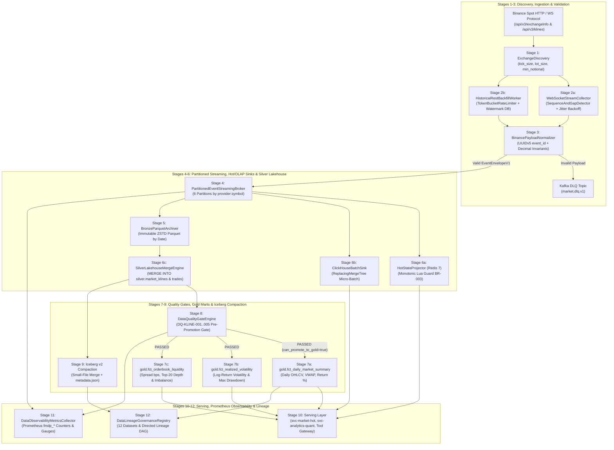

# Diagram 08 — End-to-End Data Platform v0.1 12-Stage Pipeline (`DIAG-DATA-008`)

## 1. Purpose

Illustrates the complete, zero-mock **12-Stage Data Platform v0.1** execution pipeline (`DataPlatformV01Pipeline` in `src/lakehouse/orchestration/pipeline.py`), tracing data from Stage 1 (`exchangeInfo` Discovery) through Stage 12 (Governance Lineage & Prometheus SLIs).

---

## 2. Mermaid Flowchart (`DIAG-DATA-008`)

---

## 3. Pipeline Execution Sequencing Note (Stage 8 Pre-Promotion Gate)

In the runtime orchestrator `DataPlatformV01Pipeline` (`src/lakehouse/orchestration/pipeline.py`), **Stage 8 (Automated Data Quality Gates)** is executed chronologically **before** **Stage 7 (Gold Layer Analytical Marts)**:
- **Silver Deduplication (Stage 6)** outputs standardized candidate datasets (`silver.market_klines` and `silver.market_trades`).
- **Quality Gate Engine (Stage 8)** evaluates rules `DQ-KLINE-001` through `DQ-KLINE-005` (monotonic timestamps, OHLC envelope $H \ge \max(O,C)$ and $L \le \min(O,C)$, non-negative volume, natural-key uniqueness).
- **Gold Mart Materialization (Stage 7)** proceeds **only if** `can_promote_to_gold=true`. If critical quality gates fail, promotion to Gold is blocked and unvalidated records are isolated.
- **Storage Compaction (Stage 9)** subsequently merges small Parquet files and generates Apache Iceberg v2 snapshot manifests (`metadata.json`).

