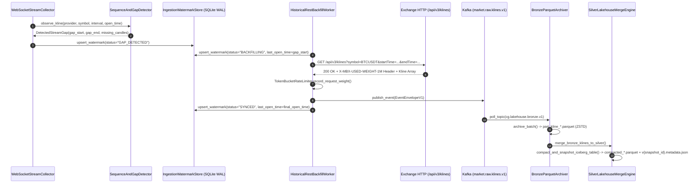

# Diagram 09 — Watermark Backfill, Gap Detection & Iceberg Compaction Lifecycle (`DIAG-DATA-009`)

| Diagram Metadata | Value |
|---|---|
| **Diagram ID** | `DIAG-DATA-009` |
| **Title** | Watermark Backfill, Gap Detection & Iceberg Compaction Lifecycle |
| **Diagram Category** | `docs/diagrams/data-platform/` |
| **Notation / Mermaid Type** | `Mermaid (sequenceDiagram)` |
| **Status** | `IMPLEMENTED` |
| **Version** | `1.1.0` |
| **Authoritative Document Reference** | `docs/architecture/14-data-platform-v01-and-microservices-architecture.md` |
| **Canonical Model Reference** | `models/data-platform/retention.yaml`, `models/process/processes.yaml` |
| **Related Artifact IDs** | `FR-02`, `FR-03`, `BR-001`, `TC-003` |

## 1. Purpose

Illustrates the closed-loop sequence governing stream gap detection (`SequenceAndGapDetector`), rate-limited REST backfill (`TokenBucketRateLimiter`), durable SQLite WAL watermark progression (`IngestionWatermarkStore` in `src/ingestion/infrastructure/watermark_store.py`; PostgreSQL target in multi-host control plane), and Stage 9 Apache Iceberg v2 small-file compaction into `.local_lakehouse/`.

---

## 2. Mermaid Sequence Diagram (`DIAG-DATA-009`)

