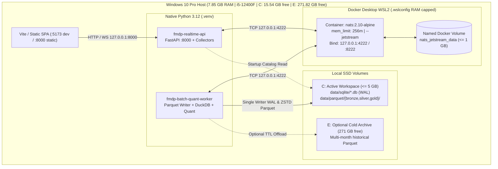

# Deployment Topology (`Hybrid Phase 2 PoC` & `Future Linux Profile`)

## Legend & Diagram Metadata

- **Solid Arrows (`-->`)**: Active Hybrid Native Windows + NATS Container runtime connections (`DEC-P0-002`).
- **Dashed Arrows (`-.->`)**: Optional cold-tier storage offloading onto `E:\` (`DEC-P0-003`) and startup metadata loading.
- **Authoritative Spec**: [resource-budget.md](../architecture/resource-budget.md), [adr-0001-three-plane-hybrid-runtime.md](../architecture/decisions/adr-0001-three-plane-hybrid-runtime.md).

