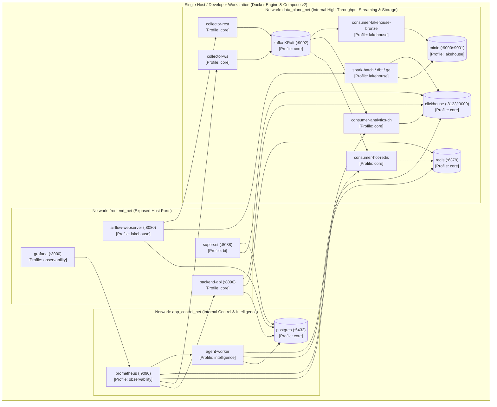

# Diagram 15: Local & Resource-Constrained Deployment Architecture (Docker Compose Profiles)

## Architectural Explanation

In compliance with Objective O7 (Resource Efficiency) and Section 9.11 (Deployment Limitations — no Kubernetes initially), the entire platform is packaged for **Docker Compose** using **modular activation profiles** and isolated virtual networks:
- **Profile `core` (Default — Lightweight Streaming & API, $\sim 4-6\text{ GB}$ RAM)**:
  - Runs `postgres`, `redis`, `kafka` (KRaft mode — no ZooKeeper overhead), `clickhouse`, `collector-ws`, `collector-rest`, `consumer-hot-redis`, `consumer-analytics-ch`, and `backend-api`.
- **Profile `lakehouse` (Batch Storage & Medallion Processing)**:
  - Adds `minio`, `consumer-lakehouse-bronze`, `spark-worker`, `dbt-runner`, `great-expectations`, and `airflow`.
- **Profile `intelligence` (Agentic Analytics)**:
  - Adds `agent-worker` (LangGraph service).
- **Profile `observability` & `bi`**:
  - Adds `prometheus`, `grafana`, and `superset`.

