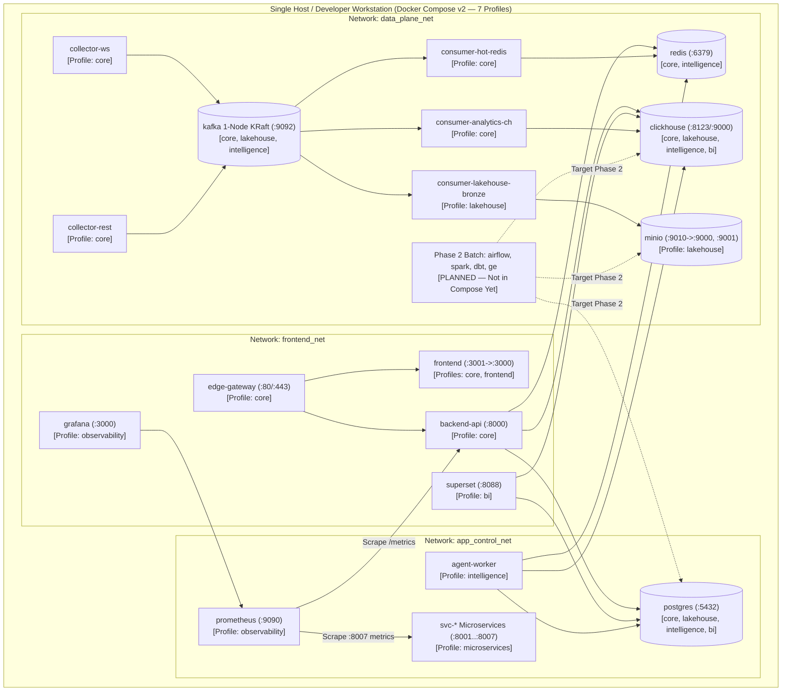

# Diagram 15: Local & Resource-Constrained Deployment Architecture (Docker Compose Profiles) (`DIAG-DEP-015`)

| Diagram Metadata | Value |
|---|---|
| **Diagram ID** | `DIAG-DEP-015` |
| **Title** | Docker Compose Profile Deployment & Network Topology |
| **Diagram Category** | `docs/diagrams/deployment/` |
| **Notation / Mermaid Type** | `Mermaid (flowchart TB)` |
| **Status** | `IMPLEMENTED` (`docker-compose.yml` 7 profiles) / `PLANNED` (Phase 2 Spark/Airflow/dbt/GE batch containers) |
| **Version** | `1.1.0` |
| **Authoritative Document Reference** | `docs/architecture/12-deployment-architecture.md`, `docs/operations/deployment-guide.md` |
| **Canonical Model Reference** | `models/deployment/deployment.yaml` |
| **Related Artifact IDs** | `DEP-001`..`DEP-008`, `PROP-APP-002` |

## Architectural Explanation

In compliance with Objective O7 (Resource Efficiency) and Section 9.11 (no Kubernetes initially), the entire platform is packaged in `docker-compose.yml` using **7 modular activation profiles** (`core`, `frontend`, `lakehouse`, `intelligence`, `observability`, `bi`, `microservices`) and 3 isolated virtual networks (`frontend_net`, `app_control_net`, `data_plane_net`):
- **Profile `core`**: `postgres`, `redis`, `kafka` (1-node KRaft), `clickhouse`, `collector-ws`, `collector-rest`, `consumer-hot-redis`, `consumer-analytics-ch`, `backend-api` (`:8000`), `frontend` (`127.0.0.1:3001->3000`), `edge-gateway` (`:80/:443`).
- **Profile `frontend`**: Runs `frontend` SPA standalone (`127.0.0.1:3001->3000`).
- **Profile `lakehouse`**: Adds `minio` (`127.0.0.1:9010->9000` API, `127.0.0.1:9001->9001` Console) and `consumer-lakehouse-bronze` (note: `spark-worker`, `dbt-runner`, `great-expectations`, and `airflow` are `[PLANNED]` Phase 2 additions — not yet in `docker-compose.yml`).
- **Profile `intelligence`**: Adds `agent-worker`.
- **Profiles `observability` & `bi`**: Add `prometheus` (`:9090`, scraping `localhost:9090`, `backend-api:8000/metrics`, `svc-data-plane-v01:8007/api/v1/data-platform/v01/metrics`), `grafana` (`:3000`), and `superset` (`:8088`).
- **Profile `microservices`**: Launches 7 domain containers `svc-market-hot..svc-data-plane-v01` (`:8001`..`:8007`) on `app_control_net` + `data_plane_net`.

