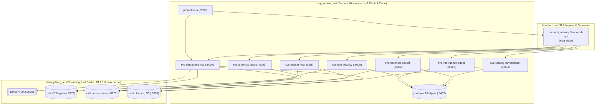

# Diagram 18 — Microservices Container Deployment & Network Isolation (`DIAG-DEP-018`)

## 1. Purpose

Illustrates the Docker Compose `--profile microservices` (`DEP-006`) container deployment topology across the three segmented internal networks (`frontend_net`, `app_control_net`, `data_plane_net`).

---

## 2. Mermaid Deployment Flowchart (`DIAG-DEP-018`)

