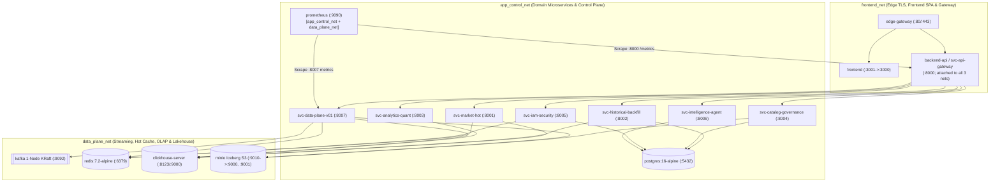

# Diagram 18 — Microservices Container Deployment & Network Isolation (`DIAG-DEP-018`)

| Diagram Metadata | Value |
|---|---|
| **Diagram ID** | `DIAG-DEP-018` |
| **Title** | Microservices Container Deployment & Network Isolation |
| **Diagram Category** | `docs/diagrams/deployment/` |
| **Notation / Mermaid Type** | `Mermaid (flowchart TB)` |
| **Status** | `IMPLEMENTED` |
| **Version** | `1.1.0` |
| **Authoritative Document Reference** | `docs/architecture/12-deployment-architecture.md`, `docs/architecture/14-data-platform-v01-and-microservices-architecture.md` |
| **Canonical Model Reference** | `models/deployment/deployment.yaml` |
| **Related Artifact IDs** | `DEP-006`, `ADR-007` |

## 1. Purpose

Illustrates the Docker Compose `--profile microservices` (`DEP-006`, paired with `core`, `lakehouse`, and `observability` profiles) container deployment topology across the three segmented networks (`frontend_net`, `app_control_net`, `data_plane_net`).

---

## 2. Mermaid Deployment Flowchart (`DIAG-DEP-018`)

