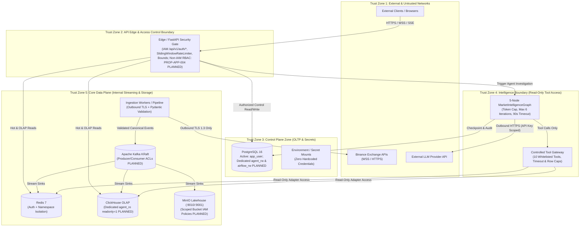

# Diagram 16: Security & Trust Boundary Diagram (`DIAG-SEC-016`)

| Diagram Metadata | Value |
|---|---|
| **Diagram ID** | `DIAG-SEC-016` |
| **Title** | Security & Trust Boundary Architecture |
| **Diagram Category** | `docs/diagrams/security/` |
| **Notation / Mermaid Type** | `Mermaid (flowchart TB)` |
| **Status** | `PARTIALLY_IMPLEMENTED` (Plane C gateway & IAM token primitives implemented; non-IAM route RBAC `[PROP-APP-004]`, `agent_ro`, `airflow_rw`, Kafka ACLs, and scoped MinIO policies `[PLANNED]`) |
| **Version** | `1.1.0` |
| **Authoritative Document Reference** | `docs/architecture/10-security-and-governance.md` |
| **Canonical Model Reference** | `models/security/threat-model.yaml` |
| **Related Artifact IDs** | `THR-001`..`THR-005`, `CTRL-001`..`CTRL-005`, `PROP-APP-004` |

## Architectural Explanation

The **Security & Trust Boundary Diagram** defines the five concentric trust zones across the platform and distinguishes active controls vs planned hardening targets:
1. **Zone 1 — Untrusted External Internet**: Public API clients, browsers, external exchange endpoints (Binance), and third-party LLM APIs.
2. **Zone 2 — Edge & API Gateway Boundary (`frontend_net`)**: Nginx (`edge-gateway`) and FastAPI install security headers, `SlidingWindowRateLimiter`, IP/endpoint masking (`IPAndEndpointCipher`), input validation, and `/api/v1/auth/*` HMAC/`PBKDF2-HMAC-SHA256` tokens. Note `[PROP-APP-004]`: non-IAM domain routers do not yet enforce route-level JWT/RBAC `Depends(...)` guards in runtime (`PLANNED`).
3. **Zone 3 — Application & Control Zone (`app_control_net`)**: Holds PostgreSQL (accessed via `POSTGRES_APP_USER` in Compose; fine-grained `agent_rw` and `airflow_rw` roles `[PLANNED]`) and operational management services.
4. **Zone 4 — Isolated Intelligence Sandbox (`agent-worker` / `src/intelligence/`, Compose `app_control_net` + `data_plane_net`)**: Runs the 5-node `MarketIntelligenceGraph`. Connects read-only through `ControlledToolGateway` (10 whitelisted tools, 5s timeout, row caps). Dedicated ClickHouse `agent_ro` (`fmdp_agent_ro`) SQL user is `[PLANNED]` in Compose init.
5. **Zone 5 — Core Data Plane Zone (`data_plane_net`)**: Houses Kafka, Redis, ClickHouse, and MinIO (`host :9010 -> :9000`, `:9001`). No external client routes directly to Zone 5 containers; Kafka producer/consumer ACLs and scoped MinIO IAM bucket policies are `[PLANNED]`.

