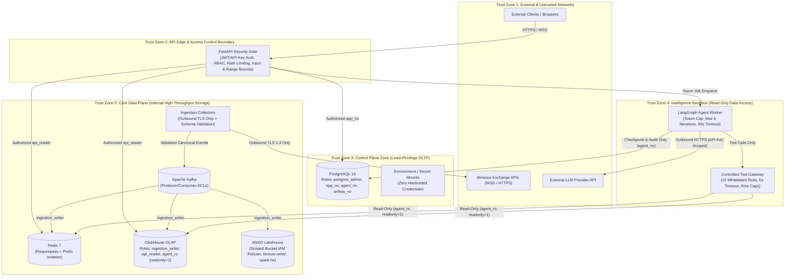

# Diagram 16: Security & Trust Boundary Diagram

## Architectural Explanation

The **Security & Trust Boundary Diagram** defines the five concentric trust zones across the platform and the mandatory controls enforced at every boundary crossing:
1. **Zone 1 — Untrusted External Internet**: Public API clients, browsers, external exchange endpoints (Binance), and third-party LLM APIs.
2. **Zone 2 — Edge & API Gateway Boundary (`frontend_net`)**: FastAPI enforces JWT/API-Key authentication, RBAC role checks, sliding-window rate limits, request payload validation, and query cost limits before any internal service is reached.
3. **Zone 3 — Application & Control Zone (`app_control_net`)**: Holds PostgreSQL (accessed via `app_rw` credentials) and operational management services.
4. **Zone 4 — Isolated Intelligence Sandbox (`intel_sandbox_net`)**: Runs the LangGraph `agent-worker`. Has **no write credentials** to any market database; connects to ClickHouse exclusively via `agent_ro` (`readonly=1`) and Redis read-only commands through the Controlled Tool Gateway.
5. **Zone 5 — Core Data Plane Zone (`data_plane_net`)**: Houses Kafka, Redis, ClickHouse, and MinIO. No external client can route directly to Zone 5 containers.

