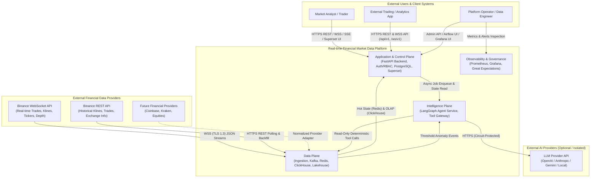

# Diagram 01: System Context Diagram (C4 Level 1)

## Architectural Explanation

The **System Context Diagram** establishes the boundary of the **Real-time Financial Market Data Platform** and its interactions with external actors and systems:

1. **External Data Providers (Upstream)**:
   - **Binance WebSocket API**: Pushes real-time market events (trades, klines, 24h tickers, order book depth) over persistent TLS WebSocket connections.
   - **Binance REST API**: Serves paginated historical klines, aggregated trades, order book snapshots, and exchange instrument metadata over HTTPS.
   - **Future Exchange Providers**: Extensible via the Collector Provider Port without altering core platform internals.
2. **External AI Infrastructure**:
   - **LLM Provider API**: Invoked asynchronously and exclusively by the Intelligence Plane for narrative synthesis and tool planning. Never sits on the critical path of data ingestion or market data serving.
3. **Human & Programmatic Consumers (Downstream)**:
   - **Market Analysts & Traders**: Query real-time prices, historical charts, quantitative analytics, and trigger AI market investigations via REST, WebSocket, and SSE APIs, or explore BI dashboards in Apache Superset.
   - **External Client Applications**: Consume versioned REST (`/api/v1/*`) and WebSocket (`/ws/v1/market/stream`) feeds.
   - **Platform Operators & Data Engineers**: Manage monitored symbols, inspect data quality and consumer lag in Grafana, and orchestrate backfills via Apache Airflow.

