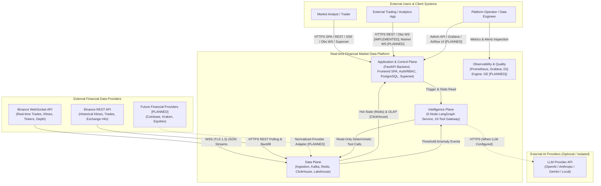

# Diagram 01: System Context Diagram (C4 Level 1) (`DIAG-CTX-001`)

| Diagram Metadata | Value |
|---|---|
| **Diagram ID** | `DIAG-CTX-001` |
| **Title** | System Context Diagram (C4 Level 1) |
| **Diagram Category** | `docs/diagrams/system/` |
| **Notation / Mermaid Type** | `Mermaid (flowchart TB)` |
| **Status** | `IMPLEMENTED` (with explicit `[PLANNED]` external `/ws/v1/market/stream`, Airflow, & GE targets) |
| **Version** | `1.1.0` |
| **Authoritative Document Reference** | `docs/architecture/01-system-context.md` |
| **Canonical Model Reference** | `models/context/system-context.yaml` |
| **Related Artifact IDs** | `CAP-001`..`CAP-006`, `API-001`..`API-056`, `SCR-002`..`SCR-007` |

## Architectural Explanation

The **System Context Diagram** establishes the boundary of the **Real-time Financial Market Data Platform** and its interactions with external actors and systems:

1. **External Data Providers (Upstream)**:
   - **Binance WebSocket API**: Pushes real-time market events (trades, klines, 24h tickers, order book depth) over persistent TLS WebSocket connections (`PLANNED` standalone daemon loop per `PROP-APP-002`; active simulation/adapter in runtime).
   - **Binance REST API**: Active HTTPS REST client fetching `exchangeInfo`, paginated historical klines, and REST snapshots.
   - **Future Exchange Providers** (`[PLANNED]`): Extensible via the Collector Provider Port without altering core platform internals.
2. **External AI Infrastructure**:
   - **LLM Provider API** (`[PARTIALLY_IMPLEMENTED / CONFIGURABLE]`): Invoked asynchronously by the Intelligence Plane for narrative synthesis when live credentials are configured (deterministic template synthesis fallback when offline). Never sits on the data ingestion critical path.
3. **Human & Programmatic Consumers (Downstream)**:
   - **Market Analysts, Traders & Frontend SPA Users**: Access `frontend` TypeScript + Vite SPA (`SCR-002`..`SCR-007` on host `:3001` / Edge `https://fmdp.local/`), REST `/api/v1/*`, Observability SSE `/api/v1/observability/stream` (`API-055`), Observability WS `/ws/v1/observability/stream` (`API-056`), and Apache Superset BI dashboards.
   - **External Client Applications**: Consume versioned REST (`/api/v1/*`, `[IMPLEMENTED]`), Observability WS/SSE (`[IMPLEMENTED]`), and planned market streaming WebSocket (`/ws/v1/market/stream` `API-003`, `[PLANNED]`).
   - **Platform Operators & Data Engineers**: Manage monitored symbols, inspect data quality (`DataQualityGateEngine` `[IMPLEMENTED]`; `Great Expectations` `[PLANNED]`), Grafana/Prometheus (`[IMPLEMENTED]`), and batch orchestration (`Apache Airflow` `[PLANNED]`).

