# Diagram 02: C4 Container Architecture Diagram (C4 Level 2)

## Architectural Explanation

The **C4 Container Diagram** decomposes the platform into its deployable containers across the three architectural planes (**Data Plane**, **Application & Control Plane**, and **Intelligence Plane**) plus the cross-cutting **Observability Plane**:

- **Data Plane Containers**:
  - `collector-ws` (Python asyncio): Subscribes to Binance WebSocket streams, validates schemas, and publishes canonical events to Kafka.
  - `collector-rest` (Python): Fetches historical data and exchange metadata from Binance REST API.
  - `kafka` (Apache Kafka KRaft): Durable event streaming backbone partitioned by `{provider}:{symbol}`.
  - `consumer-hot-redis` (Python): Consumes Kafka streams and atomically updates latest prices, snapshots, and order books in Redis.
  - `consumer-analytics-ch` (Python): Buffers Kafka events into micro-batches ($1\text{ s}$ or $5,000$ rows) and bulk-inserts into ClickHouse.
  - `consumer-lakehouse-bronze` (Python): Writes immutable raw event batches as ZSTD-compressed Parquet into MinIO Bronze tables.
  - `redis` (Redis 7): In-memory hot state store, Pub/Sub fanout, and short-TTL query cache.
  - `clickhouse` (ClickHouse Server): Columnar OLAP database with `ReplacingMergeTree` tables and Materialized Views.
  - `minio` (MinIO S3-Compatible Storage): Object storage hosting Apache Iceberg tables (Bronze, Silver, Gold).
  - `spark-worker` (PySpark) & `dbt-runner` (dbt Core) orchestrated by `airflow` (Apache Airflow): Batch Lakehouse processing and SQL modeling, validated by `great-expectations`.
- **Application & Control Plane Containers**:
  - `backend-api` (FastAPI Modular Monolith): Serves REST, WebSocket, and SSE APIs; enforces Auth/RBAC and rate limits.
  - `postgres` (PostgreSQL 16): Stores users, RBAC, platform config, watermarks, Airflow metadata, and Agent execution checkpoints.
  - `superset` (Apache Superset): Self-service BI dashboards reading from ClickHouse read-only views.
- **Intelligence Plane Container**:
  - `agent-worker` (LangGraph Service): Executes asynchronous market analysis and anomaly investigations via the deterministic Tool Gateway.

```mermaid
flowchart TB
    subgraph External["External Systems"]
        Binance["Binance WS & REST APIs"]
        LLM["External LLM Provider"]
        Users["API Clients & Analysts"]
    end

    subgraph DataPlane["Plane A: Data Plane"]
        WSCol["collector-ws<br/>(Python Async WebSocket Collector)"]
        RESTCol["collector-rest<br/>(Python Historical Collector)"]
        Kafka["Apache Kafka (KRaft)<br/>(Event Streaming Backbone)"]
        HotCons["consumer-hot-redis<br/>(Streaming State Consumer)"]
        CHCons["consumer-analytics-ch<br/>(Micro-Batch OLAP Consumer)"]
        BrzCons["consumer-lakehouse-bronze<br/>(Parquet/Iceberg Archiver)"]
        Redis[("Redis 7<br/>(Hot Cache & Pub/Sub)")]
        ClickHouse[("ClickHouse<br/>(Real-Time & Historical OLAP)")]
        MinIO[("MinIO Object Storage<br/>(Parquet + Apache Iceberg)")]
        Spark["PySpark Batch Jobs<br/>(Bronze -> Silver Lakehouse)"]
        DBT["dbt Core<br/>(Silver -> Gold & OLAP Marts)"]
        GE["Great Expectations<br/>(Data Quality Validation)"]
        Airflow["Apache Airflow<br/>(Batch Orchestrator)"]
    end

    subgraph ControlPlane["Plane B: Application & Control Plane"]
        FastAPI["backend-api<br/>(FastAPI Modular Monolith)"]
        Postgres[("PostgreSQL 16<br/>(Control Metadata, IAM, Job/Agent State)")]
        Superset["Apache Superset<br/>(BI & Visualization)"]
    end

    subgraph IntelligencePlane["Plane C: Intelligence Plane"]
        AgentWorker["agent-worker<br/>(LangGraph Orchestrator & Tool Gateway)"]
    end

    subgraph Observability["Cross-Cutting: Observability"]
        Prometheus["Prometheus<br/>(Metrics Collection)"]
        Grafana["Grafana<br/>(Dashboards & Alerting)"]
    end

    Binance -->|"WSS Streams"| WSCol
    Binance -->|"HTTPS REST"| RESTCol
    WSCol -->|"Publish Canonical Events"| Kafka
    RESTCol -->|"Publish / Stage Backfill"| Kafka
    RESTCol -->|"Update Watermarks"| Postgres

    Kafka -->|"Consume Real-Time"| HotCons
    Kafka -->|"Consume Micro-Batch"| CHCons
    Kafka -->|"Consume Archival Batch"| BrzCons

    HotCons -->|"Lua Monotonic Upsert"| Redis
    CHCons -->|"Bulk Async Insert"| ClickHouse
    BrzCons -->|"Write Bronze Parquet"| MinIO

    Airflow -->|"Trigger & Monitor"| RESTCol
    Airflow -->|"Trigger Batch"| Spark
    Airflow -->|"Trigger Models"| DBT
    Airflow -->|"Trigger Suites"| GE
    Spark -->|"Read Bronze / Write Silver Iceberg"| MinIO
    Spark -->|"Backfill Curated Data"| ClickHouse
    DBT -->|"Transform Marts"| ClickHouse
    GE -->|"Validate Tables"| ClickHouse
    GE -->|"Validate Iceberg"| MinIO

    Users -->|"HTTPS REST / WSS / SSE"| FastAPI
    Users -->|"BI Queries"| Superset
    FastAPI -->|"Hot Reads (<15ms)"| Redis
    FastAPI -->|"Historical & Analytical Reads"| ClickHouse
    FastAPI -->|"IAM, Config, Job State"| Postgres
    Superset -->|"Read-Only Analytical SQL"| ClickHouse

    FastAPI -->|"Enqueue On-Demand Run"| Postgres
    Kafka -->|"Anomaly Events (market.anomalies.v1)"| AgentWorker
    AgentWorker -->|"Read/Write Checkpoints & Reports"| Postgres
    AgentWorker -->|"Deterministic Tool Reads"| Redis
    AgentWorker -->|"Deterministic Tool Reads"| ClickHouse
    AgentWorker -->|"HTTPS (Isolated)"| LLM

    Prometheus -->|"Scrape /metrics"| WSCol
    Prometheus -->|"Scrape /metrics"| FastAPI
    Prometheus -->|"Scrape /metrics"| AgentWorker
    Grafana -->|"Query PromQL"| Prometheus
```

