# Diagram 02: C4 Container Architecture Diagram (C4 Level 2) (`DIAG-C4-002`)

| Diagram Metadata | Value |
|---|---|
| **Diagram ID** | `DIAG-C4-002` |
| **Title** | C4 Container Architecture Diagram (C4 Level 2) |
| **Diagram Category** | `docs/diagrams/system/` |
| **Notation / Mermaid Type** | `Mermaid (flowchart TB)` |
| **Status** | `IMPLEMENTED` / `PARTIALLY_IMPLEMENTED` (with explicit `[PLANNED]` Phase 2 batch containers & worker CLI loop disclosure) |
| **Version** | `1.1.0` |
| **Authoritative Document Reference** | `docs/architecture/00-architecture-overview.md`, `docs/architecture/12-deployment-architecture.md` |
| **Canonical Model Reference** | `models/architecture/architecture.yaml`, `models/architecture/components.yaml`, `models/deployment/deployment.yaml` |
| **Related Artifact IDs** | `COMP-001`..`COMP-020`, `DEP-001`..`DEP-008`, `PROP-APP-002` |

## Architectural Explanation

The **C4 Container Diagram** decomposes the platform into its Compose-defined containers across the **Data Plane**, **Experience Layer**, **Application & Control Plane**, **Intelligence Plane**, and **Observability Plane**, clearly separating deployed containers (`docker-compose.yml`) from `[PLANNED]` Phase 2 batch containers:

- **Data Plane Containers (`docker-compose.yml` + Active Monolith Pipeline)**:
  - `collector-ws`, `collector-rest`, `consumer-hot-redis`, `consumer-analytics-ch`, `consumer-lakehouse-bronze`: Defined in `docker-compose.yml` (`core` / `lakehouse` profiles); note standalone worker entrypoints (`ws_collector.py`, `rest_backfill.py`, `bronze/consumer.py`) currently contain CLI logging stubs (`[PROP-APP-002]`) while live execution runs inside `backend-api` / `svc-data-plane-v01` (`DataPlatformV01Pipeline`).
  - `kafka` (Apache Kafka 1-node KRaft in Compose, `:9092`): Durable event streaming backbone partitioned by `{provider}:{symbol}`.
  - `redis` (Redis 7, `:6379`): In-memory hot state store with monotonic Lua guard and short-TTL cache.
  - `clickhouse` (ClickHouse Server, `:8123/:9000`): Columnar OLAP database (`ReplacingMergeTree` tables & Materialized Views).
  - `minio` (MinIO Object Storage, `host :9010 -> :9000`, `:9001`): Object storage hosting Lakehouse data (alongside local `.local_lakehouse/` Parquet + Iceberg v2 manifests in v0.1).
  - `[PLANNED]` Phase 2 Batch Stack (`spark-worker` PySpark, `dbt-runner` dbt Core, `great-expectations`, `airflow`): Not yet deployed as Compose containers; v0.1 transforms and quality gates run via Python engines (`SilverLakehouseMergeEngine`, `GoldMartEngine`, `DataQualityGateEngine`).
- **Experience Layer & Edge Containers (`docker-compose.yml`)**:
  - `edge-gateway` (Nginx TLS proxy, `:80/:443`) & `frontend` (TypeScript + Vite SPA / Nginx, `host :3001 -> container :3000`): Serves Overview Dashboard (`SCR-002`), Data Flow Observatory (`SCR-003`), Market Analytics (`SCR-004`), Data Management (`SCR-005`), AI Workspace (`SCR-006`), and Administration (`SCR-007`).
- **Application & Control Plane Containers (`docker-compose.yml`)**:
  - `backend-api` (FastAPI Modular Monolith, `:8000`) plus optional `--profile microservices` `svc-*` containers (`:8001`..`:8007`).
  - `postgres` (PostgreSQL 16 on `app_control_net`, `:5432`): Control metadata, IAM, watermarks, and checkpoints.
  - `superset` (Apache Superset, `:8088`): BI visualization reading ClickHouse views.
- **Intelligence Plane Container**:
  - `agent-worker` (`docker-compose.yml` profile `intelligence` — standalone loop `[PROP-APP-002]` stub; 5-node `MarketIntelligenceGraph` active in `backend-api` / `svc-intelligence-agent`).
- **Observability Plane Containers**:
  - `prometheus` (`:9090`, scrapes `localhost:9090`, `backend-api:8000/metrics`, and `svc-data-plane-v01:8007/api/v1/data-platform/v01/metrics` per `prometheus.yml`) and `grafana` (`:3000`).

```mermaid
flowchart TB
    subgraph External["External Systems"]
        Binance["Binance WS & REST APIs"]
        LLM["External LLM Provider"]
        Users["API Clients & Analysts"]
    end

    subgraph DataPlane["Plane A: Data Plane"]
        WSCol["collector-ws<br/>(Compose Profile core; CLI Stub PROP-APP-002)"]
        RESTCol["collector-rest<br/>(Compose Profile core; CLI Stub PROP-APP-002)"]
        Kafka["Apache Kafka 1-Node KRaft<br/>(Event Streaming Backbone)"]
        HotCons["consumer-hot-redis<br/>(Compose Profile core / Pipeline)"]
        CHCons["consumer-analytics-ch<br/>(Compose Profile core / Pipeline)"]
        BrzCons["consumer-lakehouse-bronze<br/>(Compose Profile lakehouse / Pipeline)"]
        Redis[("Redis 7<br/>(Hot Cache & Monotonic Guard)")]
        ClickHouse[("ClickHouse<br/>(Real-Time & Historical OLAP)")]
        MinIO[("MinIO (:9010/:9001)<br/>+ .local_lakehouse Parquet/Iceberg")]
        PyEngine["v0.1 Python Lakehouse & DQ Engine<br/>(Silver, Gold & DQ-KLINE/TRADE)"]
        Spark["PySpark Batch [PLANNED]"]
        DBT["dbt Core [PLANNED]"]
        GE["Great Expectations [PLANNED]"]
        Airflow["Apache Airflow [PLANNED]"]
    end

    subgraph ExperienceLayer["Experience / Edge Layer"]
        Edge["edge-gateway<br/>(Nginx TLS :80/:443)"]
        FrontendApp["frontend<br/>(TypeScript + Vite SPA :3001->:3000)"]
    end

    subgraph ControlPlane["Plane B: Application & Control Plane"]
        FastAPI["backend-api (:8000)<br/>(FastAPI Monolith + Pipeline v0.1)"]
        SvcDP["svc-data-plane-v01 (:8007)<br/>(Microservices Profile)"]
        Postgres[("PostgreSQL 16 (:5432)<br/>(Control Metadata, IAM, State)")]
        Superset["Apache Superset (:8088)<br/>(BI & Visualization)"]
    end

    subgraph IntelligencePlane["Plane C: Intelligence Plane"]
        AgentWorker["agent-worker / src/intelligence<br/>(5-Node LangGraph & 10-Tool Gateway)"]
    end

    subgraph Observability["Cross-Cutting: Observability"]
        Prometheus["Prometheus (:9090)<br/>(Metrics Collection)"]
        Grafana["Grafana (:3000)<br/>(Dashboards & Alerting)"]
    end

    Binance -->|"WSS Streams"| WSCol
    Binance -->|"HTTPS REST"| RESTCol
    WSCol -->|"Publish Canonical Events"| Kafka
    RESTCol -->|"Publish / Stage Backfill"| Kafka
    RESTCol -.->|"Update Watermarks"| Postgres

    Kafka -->|"Consume Real-Time"| HotCons
    Kafka -->|"Consume Micro-Batch"| CHCons
    Kafka -->|"Consume Archival Batch"| BrzCons

    HotCons -->|"Lua Monotonic Upsert"| Redis
    CHCons -->|"Bulk Async Insert"| ClickHouse
    BrzCons -->|"Write Bronze Parquet"| MinIO
    MinIO --> PyEngine

    Airflow -.->|"Orchestrate [PLANNED]"| Spark & DBT & GE
    Spark -.->|"Bronze->Silver [PLANNED]"| MinIO
    DBT -.->|"Transform Marts [PLANNED]"| ClickHouse

    Users -->|"HTTPS"| Edge --> FrontendApp
    Edge --> FastAPI
    FrontendApp -->|"REST / SSE / Obs WS"| FastAPI
    Users -->|"Direct API (:8000)"| FastAPI
    Users -->|"BI Queries (:8088)"| Superset
    FastAPI -->|"Hot Reads [TARGET <15ms]"| Redis
    FastAPI -->|"Historical & Analytical Reads"| ClickHouse
    FastAPI -->|"IAM, Config, Job State"| Postgres
    Superset -->|"Read-Only Analytical SQL"| ClickHouse

    FastAPI -->|"Trigger Investigation"| AgentWorker
    Kafka -.->|"Anomaly Trigger [PLANNED]"| AgentWorker
    AgentWorker -->|"Checkpoints & Audit"| Postgres
    AgentWorker -->|"Deterministic Tool Reads"| Redis & ClickHouse
    AgentWorker -.->|"HTTPS (When Configured)"| LLM

    Prometheus -->|"Scrape /metrics"| FastAPI
    Prometheus -->|"Scrape /api/v1/data-platform/v01/metrics"| SvcDP
    Grafana -->|"Query PromQL"| Prometheus
```

