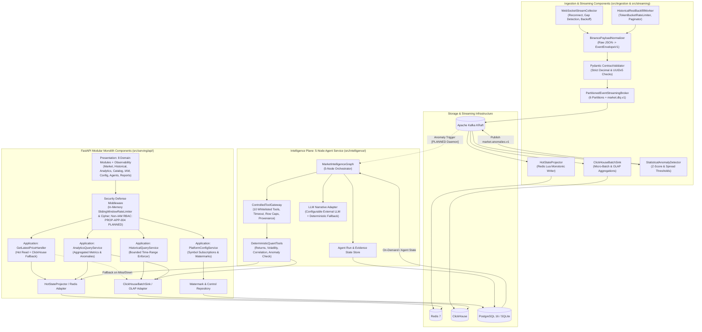

# Diagram 03: C4 Component Architecture Diagram (C4 Level 3) (`DIAG-C4-003`)

| Diagram Metadata | Value |
|---|---|
| **Diagram ID** | `DIAG-C4-003` |
| **Title** | C4 Component Architecture Diagram (C4 Level 3) |
| **Diagram Category** | `docs/diagrams/system/` |
| **Notation / Mermaid Type** | `Mermaid (flowchart TB)` |
| **Status** | `IMPLEMENTED` / `PARTIALLY_IMPLEMENTED` (in-process runtime active; non-IAM RBAC `[PROP-APP-004]` and standalone worker daemon loops `[PROP-APP-002]` pending) |
| **Version** | `1.1.0` |
| **Authoritative Document Reference** | `docs/architecture/00-architecture-overview.md`, `docs/architecture/05-backend-architecture.md` |
| **Canonical Model Reference** | `models/architecture/components.yaml` |
| **Related Artifact IDs** | `COMP-001`..`COMP-020`, `PROP-APP-002`, `PROP-APP-004` |

## Architectural Explanation

The **C4 Component Diagram** zooms into the internal components of the three primary runtime layers—**Ingestion & Streaming Workers**, **FastAPI Modular Backend** (all **8** domain modules plus Gateway Observability), and **Intelligence Plane Service**—showing how ports, adapters, domain services, and storage drivers interact across explicit boundaries.

