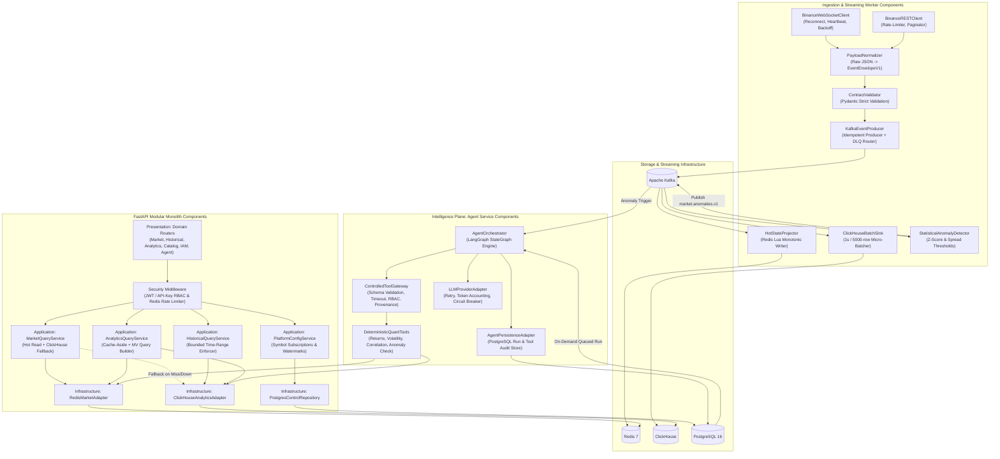

# Diagram 03: C4 Component Architecture Diagram (C4 Level 3)

## Architectural Explanation

The **C4 Component Diagram** zooms into the internal components of the three primary runtime services—**Data Collectors & Streaming Consumers**, **FastAPI Modular Backend**, and **LangGraph Agent Service**—showing how ports, adapters, domain services, and storage drivers interact across explicit boundaries.

