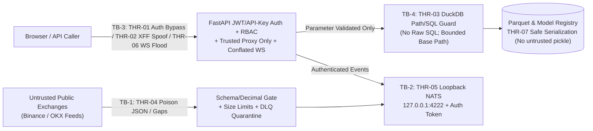

# Security Threat Model Diagram

## Legend & Diagram Metadata

- **Trust Boundaries (`TB-1..TB-4`)**: Explicit boundary points enforcing schema sanitization, RBAC, parameterized DuckDB guards, and safe artifact loading.
- **Authoritative Spec**: [threat-model.md](../architecture/threat-model.md).
