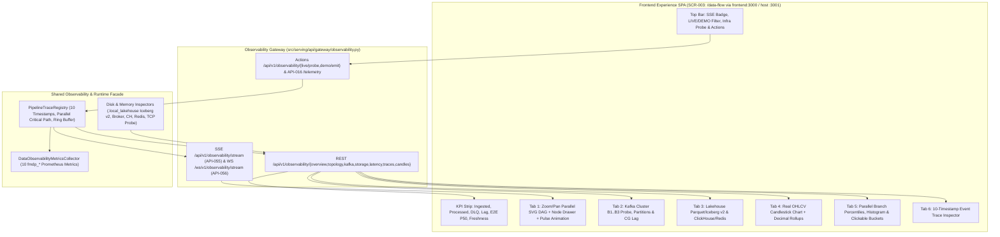

# Diagram UX-001 — Real-Time Data Flow UI & Telemetry Architecture (`DIAG-UX-001`)

| Diagram Metadata | Value |
|---|---|
| **Diagram ID** | `DIAG-UX-001` |
| **Title** | Real-Time Data Flow UI & Telemetry Architecture |
| **Diagram Category** | `docs/diagrams/ux/` |
| **Notation / Mermaid Type** | `Mermaid (flowchart TD)` |
| **Status** | `IMPLEMENTED` |
| **Version** | `2.0.0` |
| **Authoritative Document Reference** | `docs/product/11-ux/screen-specifications.md`, `docs/product/11-ux/user-flows.md` |
| **Canonical Model Reference** | `models/ux/ux.yaml` |
| **Related Artifact IDs** | `SCR-003`, `SCR-001 (DEPRECATED)`, `UX-001`, `API-017`..`API-022`, `API-051`..`API-056`, `AC-004` |

## 1. Purpose

Illustrates the TypeScript + Vite Experience Layer Observatory module (`SCR-003` at `/data-flow` in `frontend/src/modules/data-flow/DataFlowModule.ts`, served via `frontend` host port `3001` -> `:3000` and proxied by `edge-gateway` — superseding decommissioned `SCR-001` `/ui/data-flow` & deleted `src/serving/api/gateway/ui.py`), live SSE/WebSocket push, non-mutating `/api/v1/observability/*` REST endpoints (`API-017`..`API-022`, `API-051`..`API-056`), and parallel-branch trace correlation via `PipelineTraceRegistry`.

- **Authoritative Sources**: [models/ux/ux.yaml](../../../models/ux/ux.yaml), [screen-specifications.md](../../product/11-ux/screen-specifications.md), [monitoring.md](../../product/13-operations/monitoring.md)

---

## 2. Mermaid UX & Real-Time Telemetry Flowchart (`DIAG-UX-001`)

