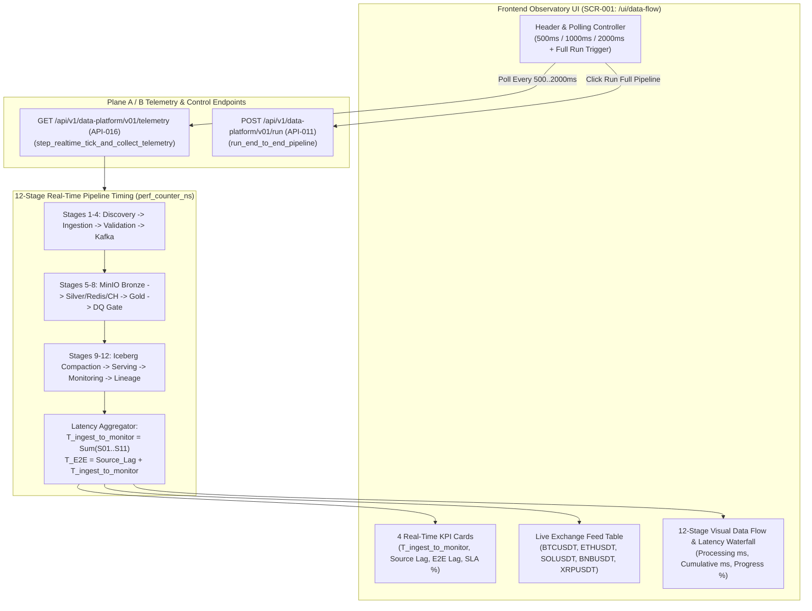

# Diagram UX-001 — Real-Time Data Flow UI & Telemetry Architecture (`DIAG-UX-001`)

## 1. Purpose

Illustrates the frontend UX/UI component hierarchy (`SCR-001`), real-time telemetry loop (`API-016`), and stage-by-stage latency calculation from **Stage 1/2 (Ingestion)** to **Stage 11/12 (Monitoring & Lineage)**.

- **Authoritative Sources**: [models/ux/ux.yaml](../../../models/ux/ux.yaml), [screen-specifications.md](../../product/11-ux/screen-specifications.md)

---

## 2. Mermaid UX & Real-Time Telemetry Flowchart (`DIAG-UX-001`)

