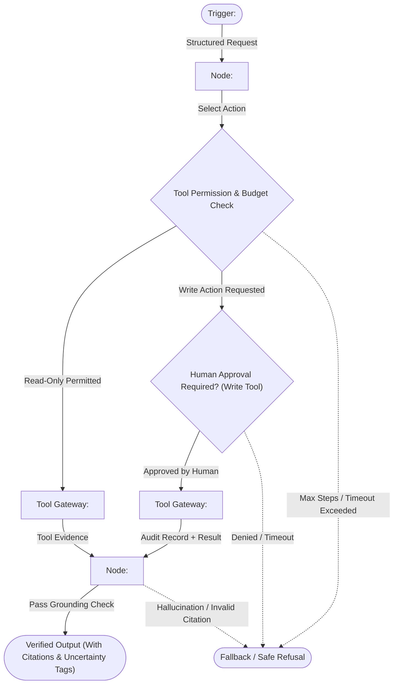

# Template: Agent Execution Workflow & Tool-Guard Diagram

Use for Intelligence Plane orchestrators, multi-step reasoning graphs, read-only vs. write-capable tool permission checks, iteration limits, fallback paths, and human approval checkpoints. Derived from an Agent Specification (`TPL-ARCH-AGENT-001`). When instantiated, set `doc_type: diagram` and `source_of_truth.is_authoritative: false`.

---

# Diagram: `<Agent / Workflow Name> Execution Graph`

## 1. Diagram Metadata `[REQUIRED]`

| Field | Value |
|---|---|
| **Diagram ID** | `DIAG-<SCOPE>-NNN` |
| **Title & Purpose** | `<Title — Agent node graph, tool permissions, and loop guard>` |
| **Owner Role & Scope** | `ai-engineer / intelligence-plane` |
| **Authoritative Source** | `[<Agent Specification>](<relative/path/to/agent-spec.md>)` (`<DOC-ID>`) |
| **Notation** | `Mermaid flowchart TD` (`Agent State / Tool Graph`) |
| **Version & Status** | `<X.Y.Z> — <DRAFT|IN_REVIEW|APPROVED|DEPRECATED>` |

## 2. Diagram `[REQUIRED]`

## 3. Legend `[REQUIRED]`

- **Rounded Pill (`([...])`)**: Agent workflow entry, verified output, or safe-refusal terminal node.
- **Diamond (`{...}`)**: Deterministic policy guard, budget/iteration limit, or human-in-the-loop approval gate.
- **Solid vs. Dashed Arrows**: Nominal execution (`-->`) vs. budget exceeded, denial, or validation failure fallback (`-.->`).
