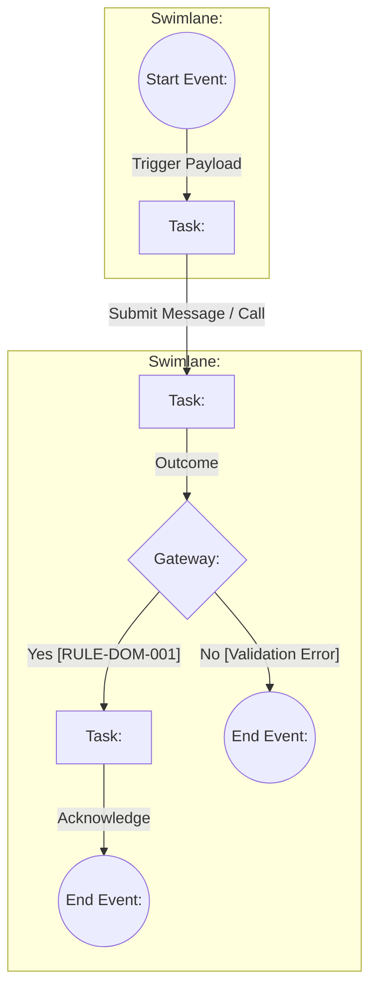

# Template: BPMN 2.0.2 Swimlane Workflow Diagram

Use for multi-actor business or operational workflows with explicit swimlane handoffs, exclusive/parallel gateways, error boundaries, or SLA timers derived from a Workflow Specification. When instantiated, set `doc_type: diagram` and `source_of_truth.is_authoritative: false`.

---

# Diagram: `<Workflow Name> (Swimlane Workflow)`

## 1. Diagram Metadata `[REQUIRED]`

| Field | Value |
|---|---|
| **Diagram ID** | `DIAG-<SCOPE>-NNN` |
| **Title & Purpose** | `<Title — One-sentence workflow scope>` |
| **Owner Role & Scope** | `<owner-role> / <capability>` |
| **Authoritative Source** | `[<Workflow Spec Title>](<relative/path/to/workflow.md>)` (`<DOC-ID>`) |
| **Notation** | `Mermaid Swimlane-style Flowchart (flowchart TB; non-BPMN 2.0.2)` *or* `Formal BPMN 2.0.2 XML` (`<workflow>.bpmn`) |
| **Version & Status** | `<X.Y.Z> — <DRAFT|IN_REVIEW|APPROVED|DEPRECATED>` |

## 2. Diagram `[REQUIRED]`

## 3. Legend `[REQUIRED]`

- **Circle (`((...))`)**: Start, intermediate, or terminating BPMN event.
- **Rectangle (`[...]`)**: Atomic task or activity owned by the enclosing swimlane.
- **Diamond (`{...}`)**: Decision or branching gateway referencing governing `RULE-...` IDs.
- **Subgraph**: Actor or system swimlane representing ownership handoff.

## 4. BPMN 2.0 XML Companion Reference `[OPTIONAL]`

- Attach a validated `.bpmn` XML path only if executable workflow modeling is required and validated against BPMN 2.0.2 XSD.
