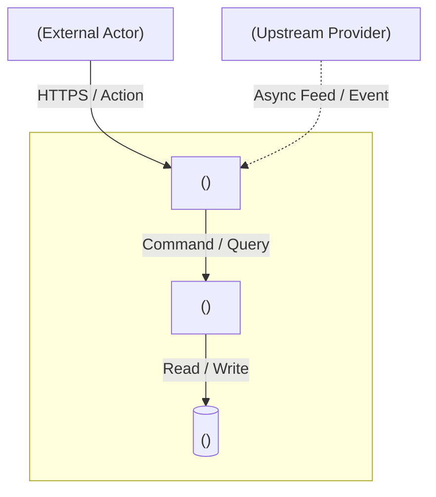

# Template: C4 Architecture Diagram

Use for **C4 Level 1 (System Context)**, **Level 2 (Container)**, or **Level 3 (Component)** views derived from an authoritative Architecture Description or Component Design document. When instantiated, set `doc_type: diagram`, `source_of_truth.is_authoritative: false`, and link the exact authoritative source document.

---

# Diagram: `<C4 Level> — <Scope Name>`

## 1. Diagram Metadata `[REQUIRED]`

| Field | Value |
|---|---|
| **Diagram ID** | `DIAG-<SCOPE>-NNN` |
| **Title & Purpose** | `<Title — One-sentence analytical scope>` |
| **C4 Level** | `<Level 1 Context | Level 2 Container | Level 3 Component>` |
| **Owner Role & Scope** | `<owner-role> / <platform|plane|capability>` |
| **Authoritative Source** | `[<Source Doc Title>](<relative/path/to/source.md>)` (`<DOC-ID>`) |
| **Notation** | `Mermaid flowchart TB` (`C4 Model`) |
| **Version & Status** | `<X.Y.Z> — <DRAFT|IN_REVIEW|APPROVED|DEPRECATED>` |

## 2. Diagram `[REQUIRED]`

## 3. Legend `[REQUIRED]`

- **Solid Arrow (`-->`)**: Synchronous request/response or blocking call (protocol labeled).
- **Dashed Arrow (`-.->`)**: Asynchronous message, stream, or scheduled batch transfer.
- **Dashed Subgraph Box**: Architectural system, plane, or container boundary.
- **Database Cylinder (`[(...)]`)**: Persistent state store or analytical storage tier.

## 4. Mapping Notes `[CONDITIONAL: Required when AS-IS differs from TARGET]`

- Explicitly note any depicted component or edge whose `implementation_status` is `SIMULATED` or `PLANNED` (MUST match Section 5 of the authoritative Architecture Description).
