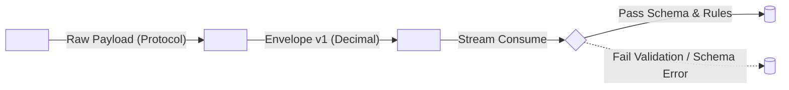

# Template: Data Flow & Lineage Diagram (DFD)

Use for pipelines, broker fan-out, medallion stage transformations, quality gates, dead-letter routing, and serving sink paths. Derived strictly from Data Architecture and Data Contract specs. When instantiated, set `doc_type: diagram` and `source_of_truth.is_authoritative: false`.

---

# Diagram: `<Pipeline / Domain Name> Data Flow`

## 1. Diagram Metadata `[REQUIRED]`

| Field | Value |
|---|---|
| **Diagram ID** | `DIAG-<SCOPE>-NNN` |
| **Title & Purpose** | `<Title — One-sentence data lineage scope>` |
| **Owner Role & Scope** | `data-architect / <plane|capability>` |
| **Authoritative Source** | `[<Data Architecture / Data Model>](<relative/path/to/source.md>)` (`<DOC-ID>`) |
| **Notation** | `Mermaid flowchart LR` (`DFD`) |
| **Version & Status** | `<X.Y.Z> — <DRAFT|IN_REVIEW|APPROVED|DEPRECATED>` |

## 2. Diagram `[REQUIRED]`

## 3. Legend `[REQUIRED]`

- **Rectangle (`[...]`)**: Active collector, stream consumer, or batch job.
- **Diamond (`{...}`)**: Schema, freshness, or financial invariant quality gate.
- **Cylinder (`[(...)]`)**: Durable event log, object store tier, or database sink.
- **Solid vs. Dashed Arrows**: Primary data lineage (`-->`) vs. quarantine/DLQ side-path (`-.->`).
