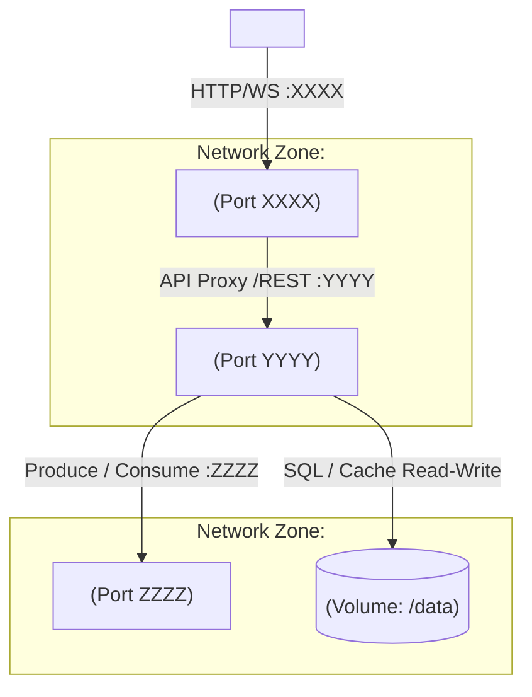

# Template: Deployment & Runtime Topology Diagram

Use when documenting runtime containers, host ports, network segments, volumes, or deployment environments derived from a Deployment Description and verified against actual Compose/IaC definitions. When instantiated, set `doc_type: diagram` and `source_of_truth.is_authoritative: false`.

---

# Diagram: `<Environment / Plane> Deployment Topology`

## 1. Diagram Metadata `[REQUIRED]`

| Field | Value |
|---|---|
| **Diagram ID** | `DIAG-<SCOPE>-NNN` |
| **Title & Purpose** | `<Title — One-sentence topology scope>` |
| **Owner Role & Scope** | `devops-sre / <platform|plane|capability>` |
| **Authoritative Source** | `[<Deployment Description>](<relative/path/to/deployment.md>)` (`<DOC-ID>`) |
| **Notation** | `Mermaid flowchart TB` (`Deployment Topology`) |
| **Version & Status** | `<X.Y.Z> — <DRAFT|IN_REVIEW|APPROVED|DEPRECATED>` |

## 2. Diagram `[REQUIRED]`

## 3. Legend `[REQUIRED]`

- **Subgraph**: Docker network, security zone, or host boundary.
- **Port Label**: Verified container/host port from deployment configuration.
- **Explicit Implementation Tag**: Label unimplemented `TARGET` infrastructure separately if the diagram shows planned vs. active services.
