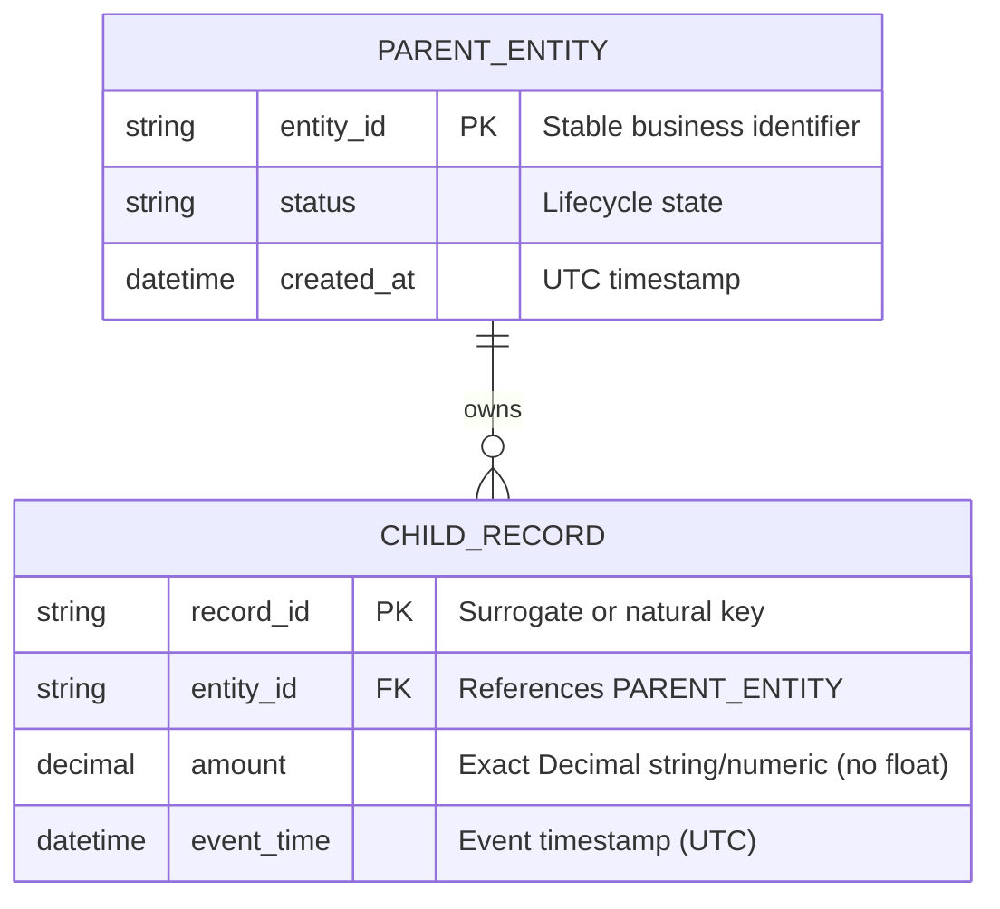

# Template: Entity-Relationship Diagram (ERD)

Use for capabilities that own relational tables, analytical schemas, or cross-entity key structures (`MEDIUM` / `HIGH_CRITICAL` DB capabilities). Derived strictly from Data Model and Database Design docs. When instantiated, set `doc_type: diagram` and `source_of_truth.is_authoritative: false`.

---

# Diagram: `<Domain / Schema Name> ERD`

## 1. Diagram Metadata `[REQUIRED]`

| Field | Value |
|---|---|
| **Diagram ID** | `DIAG-<SCOPE>-NNN` |
| **Title & Purpose** | `<Title — One-sentence data model scope>` |
| **Model Level** | `<Logical | Physical>` |
| **Owner Role & Scope** | `database-architect / <plane|capability>` |
| **Authoritative Source** | `[<Data Model / DB Design>](<relative/path/to/data-model.md>)` (`<DOC-ID>`) |
| **Notation** | `Mermaid erDiagram` (`Crow's Foot`) |
| **Version & Status** | `<X.Y.Z> — <DRAFT|IN_REVIEW|APPROVED|DEPRECATED>` |

## 2. Diagram `[REQUIRED]`

## 3. Legend `[REQUIRED]`

- **`||--o{`**: One-to-zero-or-many cardinality relationship.
- **`PK` / `FK` / `UK`**: Primary Key, Foreign Key, or Unique constraint.
- **Note**: Analytical stores without enforced foreign keys (e.g., ClickHouse / Iceberg) MUST still label logical join keys as `FK (logical)` in descriptions.
