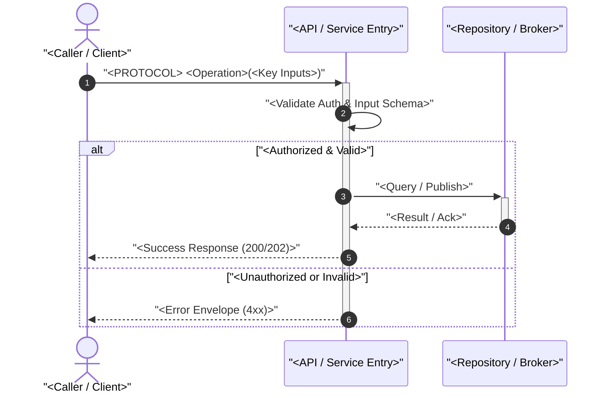

# Template: UML Sequence Diagram

Use for multi-step synchronous or asynchronous call flows showing participant order, protocol messages, timeouts, retries, auth checks, and failure branches. Derived from a Component Design, Use Case, or API Contract. When instantiated, set `doc_type: diagram` and `source_of_truth.is_authoritative: false`.

---

# Diagram: `<Scenario / Flow Name> (Sequence)`

## 1. Diagram Metadata `[REQUIRED]`

| Field | Value |
|---|---|
| **Diagram ID** | `DIAG-<SCOPE>-NNN` |
| **Title & Purpose** | `<Title — One-sentence interaction purpose>` |
| **Owner Role & Scope** | `<owner-role> / <capability|use-case>` |
| **Authoritative Source** | `[<Source Spec / Contract>](<relative/path/to/source>)` (`<DOC-ID>`) |
| **Notation** | `Mermaid sequenceDiagram` (`UML 2.5.1`) |
| **Version & Status** | `<X.Y.Z> — <DRAFT|IN_REVIEW|APPROVED|DEPRECATED>` |

## 2. Diagram `[REQUIRED]`

## 3. Legend `[REQUIRED]`

- **Solid Arrow (`->>`)**: Synchronous request/command.
- **Dashed Arrow (`-->>`)**: Return response or asynchronous acknowledgement.
- **`alt` / `else` Block**: Mutually exclusive execution paths governed by explicit precondition/error rules.
- **Lifeline Activation (`+` / `-`)**: Active processing window per participant.
