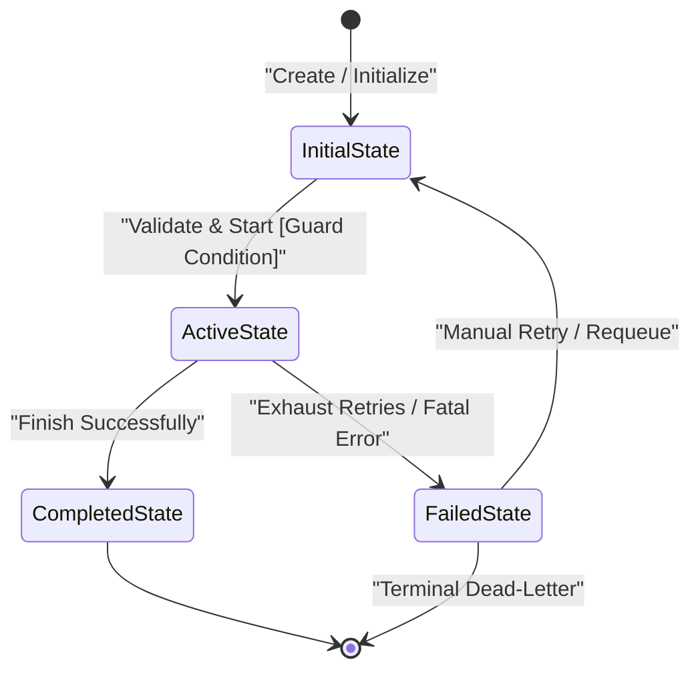

# Template: UML State Machine Diagram

Use when an entity, job, session, run, or document possesses >=3 distinct lifecycle states with guarded transitions or failure/terminal states. When instantiated, set `doc_type: diagram` and `source_of_truth.is_authoritative: false`.

---

# Diagram: `<Entity / Job Name> State Machine`

## 1. Diagram Metadata `[REQUIRED]`

| Field | Value |
|---|---|
| **Diagram ID** | `DIAG-<SCOPE>-NNN` |
| **Title & Purpose** | `<Title — One-sentence lifecycle scope>` |
| **Owner Role & Scope** | `<owner-role> / <capability>` |
| **Authoritative Source** | `[<Domain / Component Spec>](<relative/path/to/source.md>)` (`<DOC-ID>`) |
| **Notation** | `Mermaid stateDiagram-v2` (`UML 2.5.1`) |
| **Version & Status** | `<X.Y.Z> — <DRAFT|IN_REVIEW|APPROVED|DEPRECATED>` |

## 2. Diagram `[REQUIRED]`

## 3. Legend `[REQUIRED]`

- **`[*]`**: Initial pseudostate (entry) or final terminal state (exit).
- **State Box**: Persisted lifecycle state matching the authoritative enum/code constants.
- **Transition Label (`Event [Guard]`)**: Trigger event plus optional guard rule (`RULE-...`).
