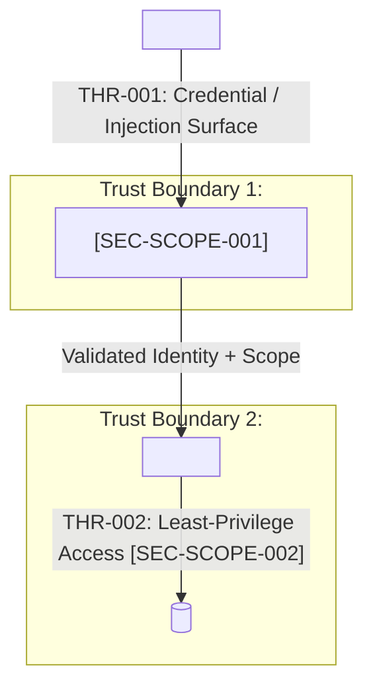

# Template: Security Threat Model & Trust Boundary Diagram

Use for all `HIGH_CRITICAL` risk capabilities, authentication/authorization modules, externally exposed endpoints, and write-capable Agent tools. Derived from the authoritative Threat Model document (`TPL-SEC-TM-001`). When instantiated, set `doc_type: diagram` and `source_of_truth.is_authoritative: false`.

---

# Diagram: `<Scope Name> Threat Model`

## 1. Diagram Metadata `[REQUIRED]`

| Field | Value |
|---|---|
| **Diagram ID** | `DIAG-<SCOPE>-NNN` |
| **Title & Purpose** | `<Title — Trust boundaries, entry points, and threat vectors>` |
| **Owner Role & Scope** | `security-architect / <platform|plane|capability>` |
| **Authoritative Source** | `[<Threat Model Document>](<relative/path/to/threat-model.md>)` (`<DOC-ID>`) |
| **Notation** | `Mermaid flowchart TB` (`Trust Boundary DFD`) |
| **Version & Status** | `<X.Y.Z> — <DRAFT|IN_REVIEW|APPROVED|DEPRECATED>` |

## 2. Diagram `[REQUIRED]`

## 3. Legend `[REQUIRED]`

- **Subgraph (`Trust Boundary`)**: Privilege, network, or process isolation boundary across which inputs MUST be authenticated and validated.
- **`THR-###`**: Threat ID cross-referenced to `threat-model.md`.
- **`SEC-###`**: Mitigating control ID (`AS-IS` gaps MUST be marked `[GAP]` rather than implied implemented).
