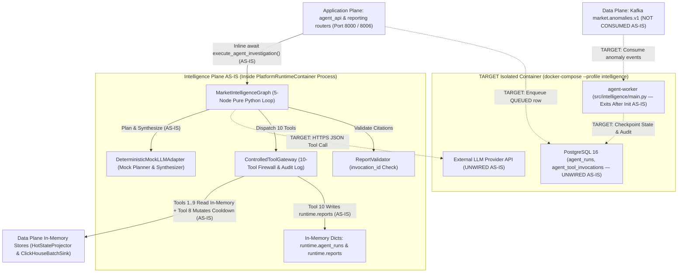

# C4 Container Diagram: Intelligence Plane

## 1. Diagram Metadata

| Field | Value |
|---|---|
| **Diagram ID** | `DIAG-INT-C4-001` |
| **Title & Purpose** | C4 Level 2 Container View showing Intelligence Plane containers, external stores, and `AS-IS` vs `TARGET` process boundaries |
| **Owner Role & Scope** | `ai-engineer / intelligence-plane` |
| **Authoritative Source** | [intelligence-architecture.md](../intelligence-architecture.md) (`INT-ARCH-001`) |
| **Notation** | `Mermaid flowchart TB` (`C4 Level 2 Container`) |
| **Version & Status** | `2.0.0 — DRAFT` |

## 2. Diagram

## 3. Legend

- **Solid Container / Solid Arrows (`-->`)**: Active `AS-IS` execution path inside `PlatformRuntimeContainer` (`src/serving/infrastructure/runtime.py`).
- **Dashed Arrows (`-.->`)**: `TARGET` asynchronous worker, Kafka anomaly consumer, external LLM API, and PostgreSQL persistence not yet wired at runtime.

