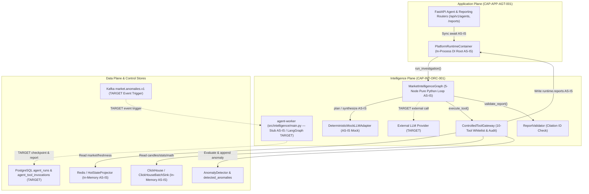

# Intelligence Plane C4 Container Diagram

| Field | Value |
|---|---|
| **Diagram ID** | `DIAG-INT-C4-001` |
| **Purpose** | Visualize Intelligence Plane containers, cross-plane boundaries, and AS-IS vs TARGET runtime wiring. |
| **Scope & Owner** | `plane` (`intelligence-plane`) / `ai-engineer` |
| **Authoritative Source** | [intelligence-architecture.md](../intelligence-architecture.md) (`INT-ARCH-001`) |
| **Notation** | Mermaid `flowchart TB` (C4 Level 2 Container View) |
| **Version & Status** | `2.0.0` / `DRAFT` (`SIMULATED`) |

**Legend**: Solid arrows (`-->`) denote `AS-IS` implemented runtime paths; dashed arrows (`-.->`) denote `TARGET` unimplemented paths.

