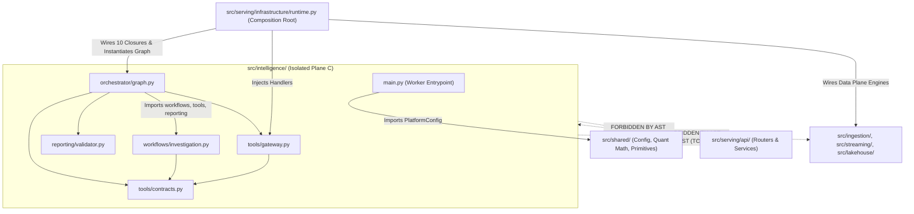

# Intelligence Plane Dependency & Clean Architecture AST Boundary Diagram

## 1. Diagram Metadata

| Field | Value |
|---|---|
| **Diagram ID** | `DIAG-INT-DEP-001` |
| **Title & Purpose** | Directed Acyclic Import Graph and AST Isolation Rules for `src/intelligence/` |
| **Owner Role & Scope** | `ai-engineer / intelligence-plane` |
| **Authoritative Source** | [intelligence-architecture.md](../intelligence-architecture.md) (`INT-ARCH-001`) |
| **Notation** | `Mermaid flowchart TB` (`Component Dependency Graph`) |
| **Version & Status** | `2.0.0 — DRAFT` |

## 2. Diagram

## 3. Legend

- **Solid Arrows (`-->`)**: Permitted Python `import` dependencies verified by `tests/architecture/test_clean_architecture_boundaries.py`.
- **Dashed Arrows (`-.->`)**: Strictly prohibited cross-plane imports enforced by AST static checks (`TC-006`).

