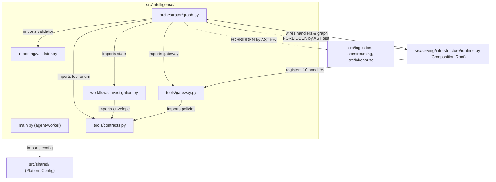

# Intelligence Plane Dependency Diagram

| Field | Value |
|---|---|
| **Diagram ID** | `DIAG-INT-DEP-001` |
| **Purpose** | Show allowed and forbidden Python import dependencies inside `src/intelligence/` and across subsystems. |
| **Scope & Owner** | `plane` (`intelligence-plane`) / `ai-engineer` |
| **Authoritative Source** | [intelligence-architecture.md](../intelligence-architecture.md) (`INT-ARCH-001`) |
| **Notation** | Mermaid `flowchart TB` (Module Dependency Graph) |
| **Version & Status** | `2.0.0` / `DRAFT` (`IMPLEMENTED`) |

**Legend**: Solid arrows (`-->`) denote permitted Python imports verified by `test_clean_architecture_boundaries.py`; dashed arrows (`-.->`) denote prohibited dependencies.

