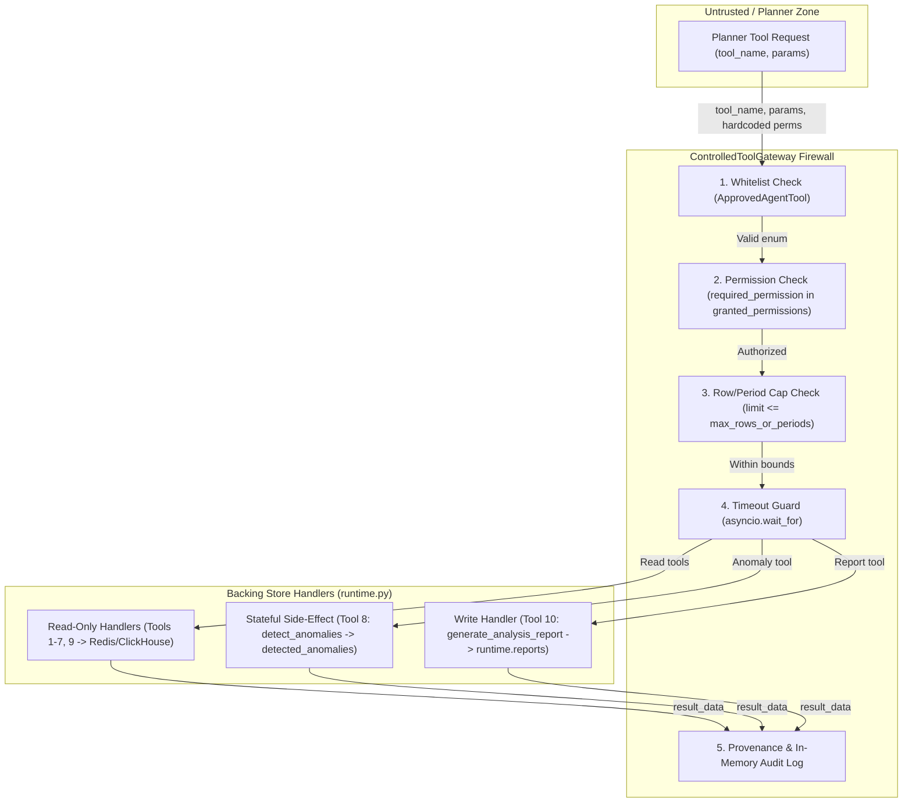

# Tool Gateway Trust Boundary Diagram

| Field | Value |
|---|---|
| **Diagram ID** | `DIAG-INT-GW-001` |
| **Purpose** | Depict trust boundaries and security checks enforced by `ControlledToolGateway` before touching backing stores. |
| **Scope & Owner** | `plane` (`intelligence-plane`) / `security-architect` |
| **Authoritative Source** | [tool-gateway-architecture.md](../tool-gateway-architecture.md) (`INT-ARCH-GW-001`) |
| **Notation** | Mermaid `flowchart TB` (Trust Boundary DFD) |
| **Version & Status** | `2.0.0` / `DRAFT` (`PARTIALLY_IMPLEMENTED`) |

**Legend**: Boxes represent trust zones (`Z1` Planner, `Z2` Gateway Firewall, `Z3` Injected Store Handlers). `Z2` enforces whitelist, RBAC, row cap, and timeout before any handler runs.

