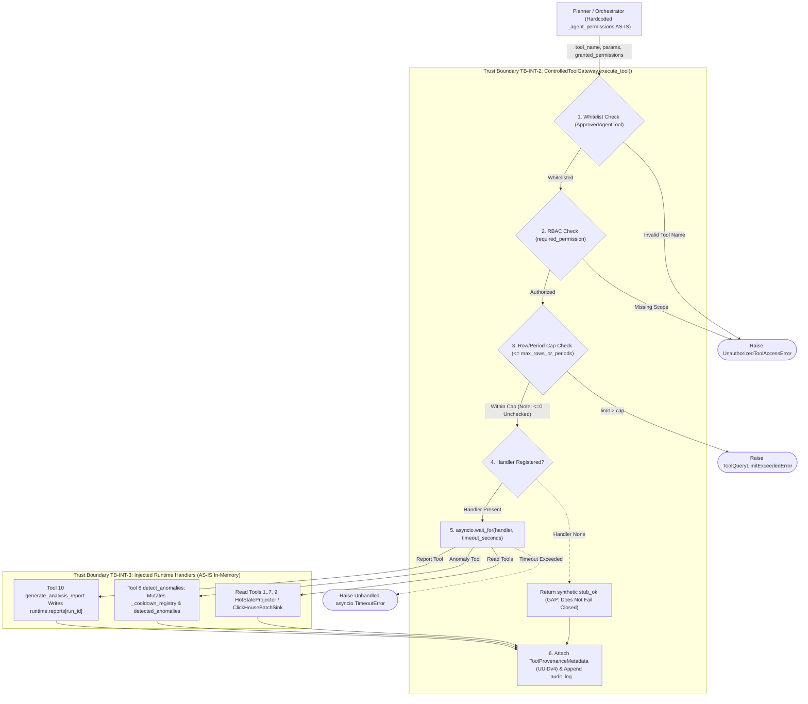

# Tool Gateway Trust Boundary & Guardrail Pipeline Diagram

## 1. Diagram Metadata

| Field | Value |
|---|---|
| **Diagram ID** | `DIAG-INT-GW-001` |
| **Title & Purpose** | ControlledToolGateway Security Gates, Timeout Bounds, Provenance Wrapping & Side-Effect Paths |
| **Owner Role & Scope** | `security-architect / intelligence-plane` |
| **Authoritative Source** | [tool-gateway-architecture.md](../tool-gateway-architecture.md) (`INT-ARCH-GW-001`) |
| **Notation** | `Mermaid flowchart TB` (`Trust Boundary Flow`) |
| **Version & Status** | `2.0.0 — DRAFT` |

## 2. Diagram

## 3. Legend

- **Diamond (`{...}`)**: Sequential deterministic policy gate inside `src/intelligence/tools/gateway.py`.
- **Rounded Pill (`([...])`)**: Unhandled exception propagation paths (not currently logged into `ControlledToolGateway._audit_log`).
- **Dashed Arrows (`-.->`)**: Fallback stub path when no handler is registered or timeout failure branch.

