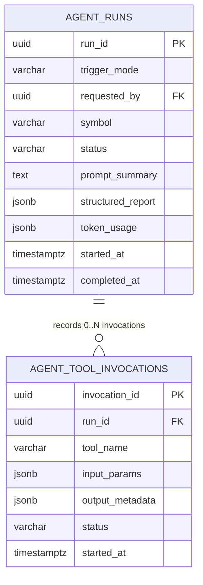

# Agent State & Tool Invocation ERD

| Field | Value |
|---|---|
| **Diagram ID** | `DIAG-INT-ORC-ERD-001` |
| **Purpose** | Visualize the `TARGET` PostgreSQL persistence model (`01_schema.sql`) vs `AS-IS` in-memory `AgentWorkflowState`. |
| **Scope & Owner** | `capability` (`CAP-INT-ORC-001`) / `data-architect` |
| **Authoritative Source** | [data-model.md](data-model.md) (`CAP-INT-ORC-DM-001`) |
| **Notation** | Mermaid `erDiagram` (Crow's Foot) |
| **Version & Status** | `2.0.0` / `DRAFT` (`NOT_IMPLEMENTED` in runtime) |

**Legend**: Tables reflect `deploy/postgres/init/01_schema.sql` (`TARGET` persistence; `AS-IS` runtime uses in-memory `runtime.agent_runs` and `ControlledToolGateway._audit_log`).

