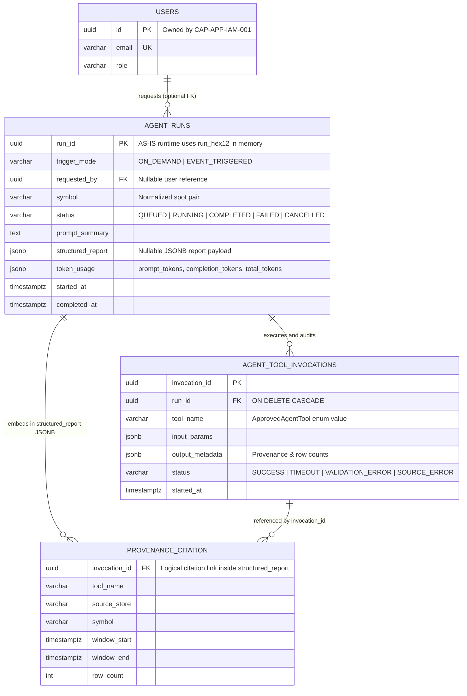

# ERD: Agent Runs, Tool Invocations & Structured Reports

## 1. Diagram Metadata

| Field | Value |
|---|---|
| **Diagram ID** | `DIAG-INT-ORC-ERD-001` |
| **Title & Purpose** | Entity-Relationship view of `users` (ref), `agent_runs`, `agent_tool_invocations`, and logical `StructuredAnalysisReport` |
| **Owner Role & Scope** | `database-architect / CAP-INT-ORC-001` |
| **Authoritative Source** | [data-model.md](data-model.md) (`CAP-INT-ORC-DM-001`) & [database-design.md](database-design.md) (`CAP-INT-ORC-DB-001`) |
| **Notation** | `Mermaid erDiagram` (`Crow's Foot`) |
| **Version & Status** | `2.0.0 — DRAFT` |

## 2. Diagram

## 3. Legend

- **`USERS` (`CAP-APP-IAM-001`)**: Referenced via nullable `requested_by` FK (`01_schema.sql:44`); not owned by Intelligence Plane.
- **`AGENT_RUNS` & `AGENT_TOOL_INVOCATIONS`**: Declared in `deploy/postgres/init/01_schema.sql:41-66`; currently `NOT_IMPLEMENTED` in runtime (stored in Python dicts `AS-IS`).
- **`PROVENANCE_CITATION`**: Embedded inside `structured_report` JSONB (`StructuredAnalysisReport.provenance_citations`) and verified against `evidence_trail` (`AGENT_TOOL_INVOCATIONS`).

