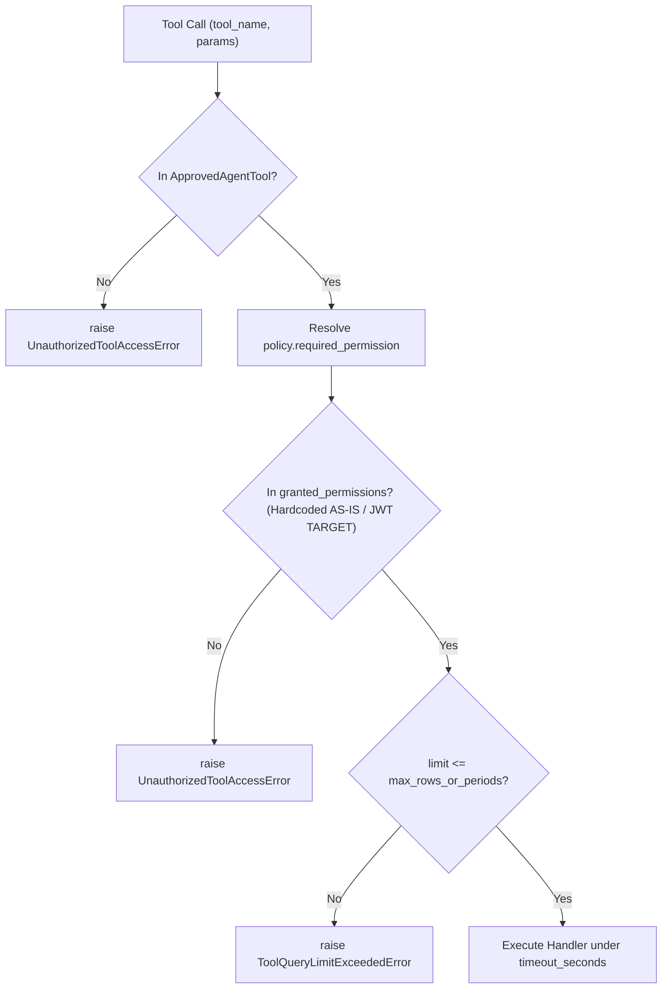

# Agent Tool Authorization Flow

| Field | Value |
|---|---|
| **Diagram ID** | `DIAG-INT-ORC-AUTHZ-001` |
| **Purpose** | Show how `granted_permissions` are evaluated in `ControlledToolGateway` (`AS-IS` hardcoded vs `TARGET` JWT-propagated). |
| **Scope & Owner** | `capability` (`CAP-INT-ORC-001`) / `security-architect` |
| **Authoritative Source** | [authorization-matrix.yaml](authorization-matrix.yaml) |
| **Notation** | Mermaid `flowchart TD` |
| **Version & Status** | `2.0.0` / `DRAFT` (`PARTIALLY_IMPLEMENTED`) |

**Legend**: Decision diamonds mark sequential authorization and resource-bound gates inside `ControlledToolGateway.execute_tool()`.

