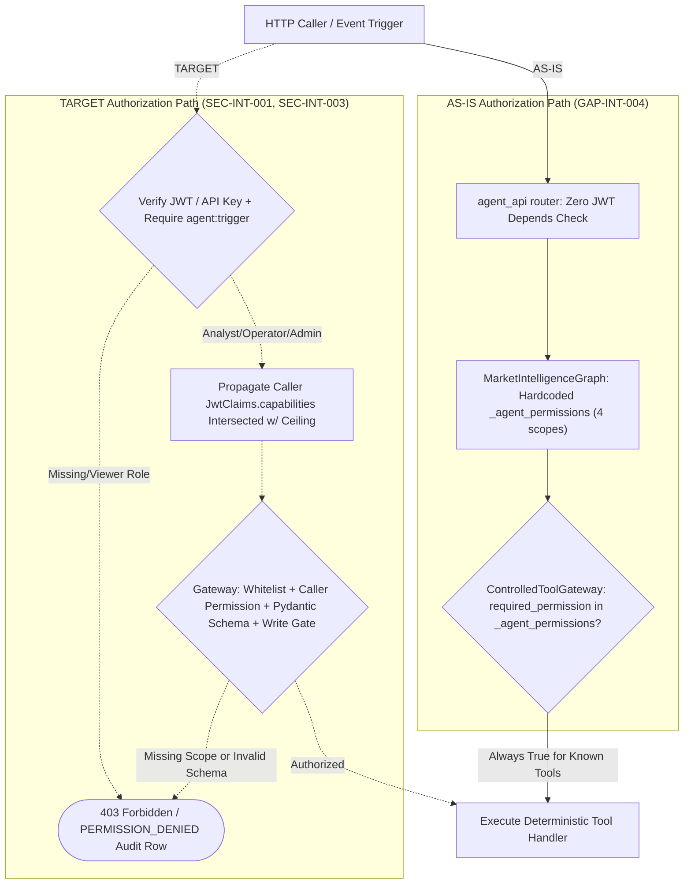

# Agent Tool Authorization Flow (`AS-IS` Hardcoded vs `TARGET` Caller RBAC)

## 1. Diagram Metadata

| Field | Value |
|---|---|
| **Diagram ID** | `DIAG-INT-ORC-AUTHZ-001` |
| **Title & Purpose** | Contrast between `AS-IS` hardcoded `_agent_permissions` and `TARGET` caller JWT RBAC + write-tool separation |
| **Owner Role & Scope** | `security-architect / CAP-INT-ORC-001` |
| **Authoritative Source** | [side-effect-and-approval-policy.md](side-effect-and-approval-policy.md) (`CAP-INT-ORC-POL-001`) |
| **Notation** | `Mermaid flowchart TD` (`Authorization Flow`) |
| **Version & Status** | `2.0.0 — DRAFT` |

## 2. Diagram

## 3. Legend

- **Solid Path (`-->`)**: Active `AS-IS` path where caller identity is unchecked and `MarketIntelligenceGraph` injects hardcoded permissions.
- **Dashed Path (`-.->`)**: `TARGET` end-to-end RBAC enforcement required by `SEC-INT-001` and `SEC-INT-003`.

