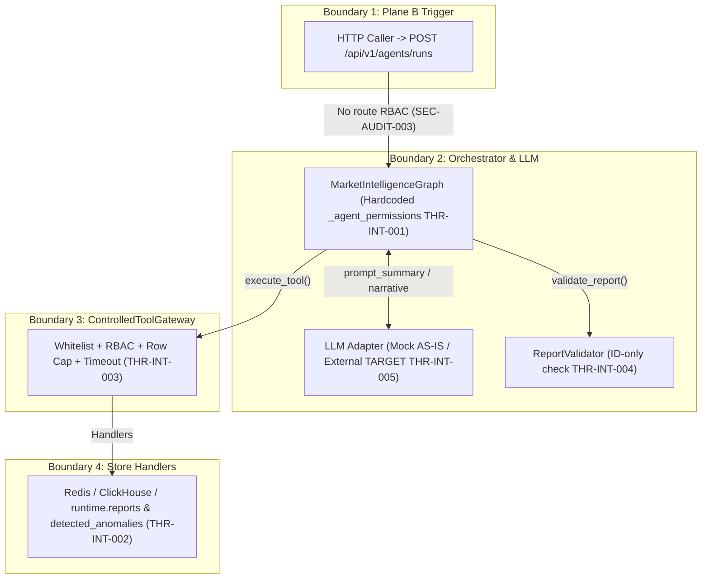

# Threat Model Diagram (`CAP-INT-ORC-001`)

| Field | Value |
|---|---|
| **Diagram ID** | `DIAG-INT-ORC-TM-001` |
| **Purpose** | Visualize trust boundaries and threat vectors (`THR-INT-001..005`) across Plane B -> Plane C -> Stores. |
| **Scope & Owner** | `capability` (`CAP-INT-ORC-001`) / `security-architect` |
| **Authoritative Source** | [threat-model.md](threat-model.md) (`CAP-INT-ORC-TM-001`) |
| **Notation** | Mermaid `flowchart TB` (Trust Boundary Diagram) |
| **Version & Status** | `2.0.0` / `DRAFT` (`PARTIALLY_IMPLEMENTED`) |

**Legend**: Subgraphs `B1..B4` represent security trust boundaries; threat IDs (`THR-INT-001..005`) annotate active and `TARGET` risks.

