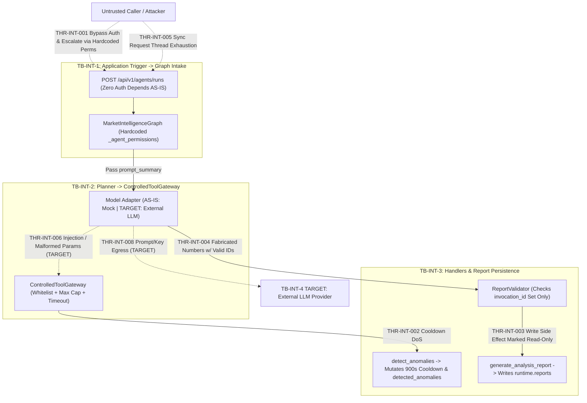

# Threat Model Diagram: Intelligence Plane Attack Paths & Controls

## 1. Diagram Metadata

| Field | Value |
|---|---|
| **Diagram ID** | `DIAG-INT-ORC-TM-001` |
| **Title & Purpose** | Attack Vectors, Trust Boundaries (`TB-INT-1..4`), and Control Gaps in `CAP-INT-ORC-001` |
| **Owner Role & Scope** | `security-architect / CAP-INT-ORC-001` |
| **Authoritative Source** | [threat-model.md](threat-model.md) (`CAP-INT-ORC-TM-001`) |
| **Notation** | `Mermaid flowchart TB` (`Threat Model DFD`) |
| **Version & Status** | `2.0.0 — DRAFT` |

## 2. Diagram

## 3. Legend

- **Dashed Arrows (`-.->`)**: Unmitigated `AS-IS` exploit paths (`THR-INT-001`, `THR-INT-005`) or `TARGET` external-LLM threat vectors (`THR-INT-006`, `THR-INT-008`).
- **Solid Arrows (`-->`)**: Active internal execution hops exhibiting metadata/validation weaknesses (`THR-INT-002`, `THR-INT-003`, `THR-INT-004`).

